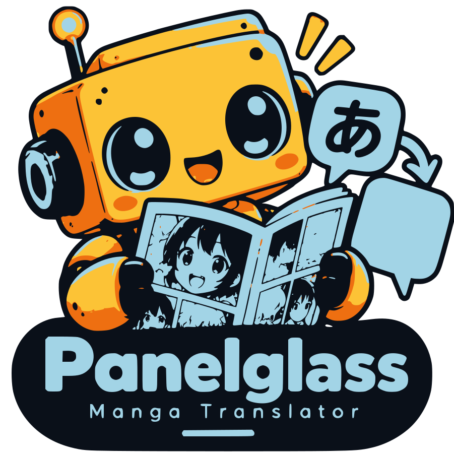
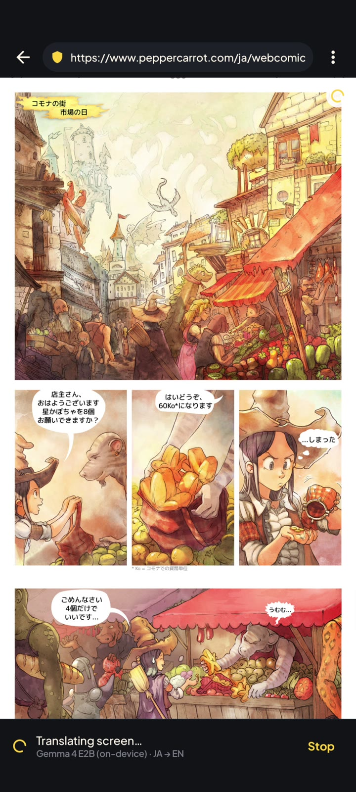
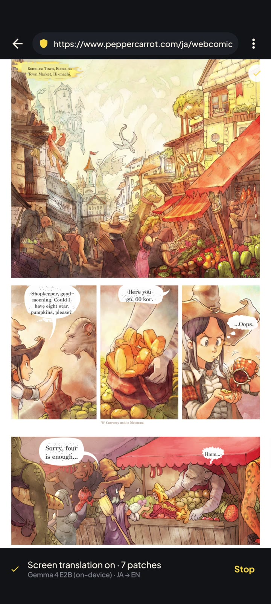
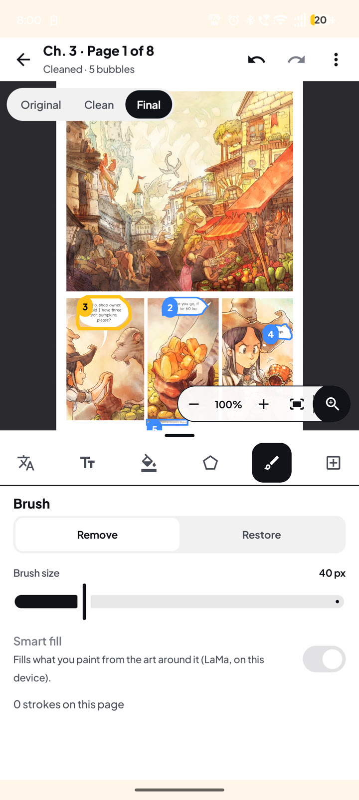
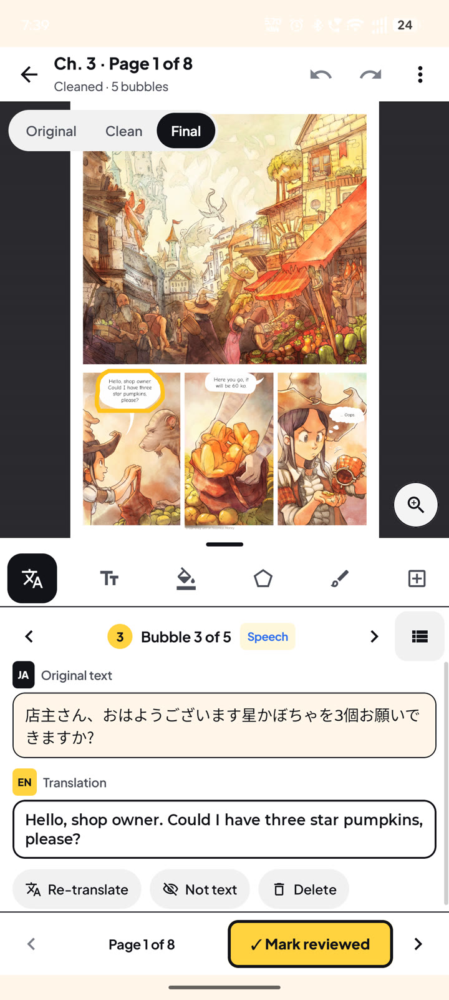
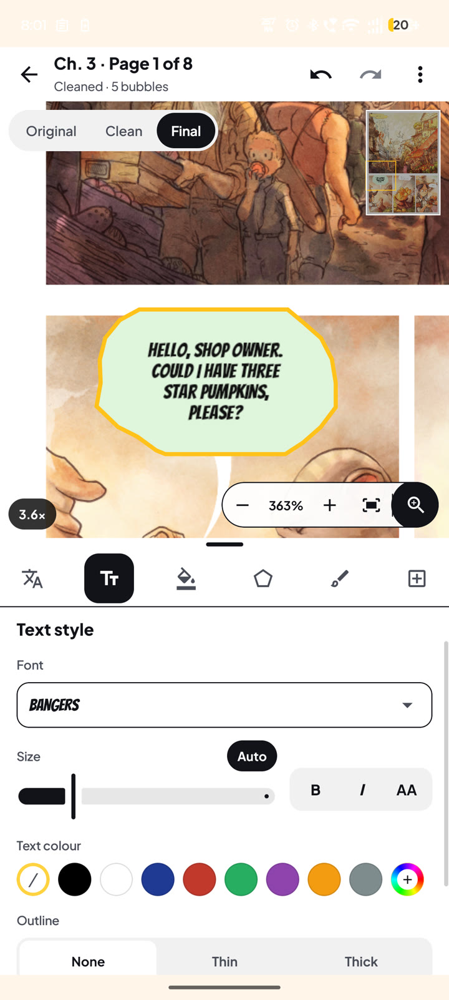
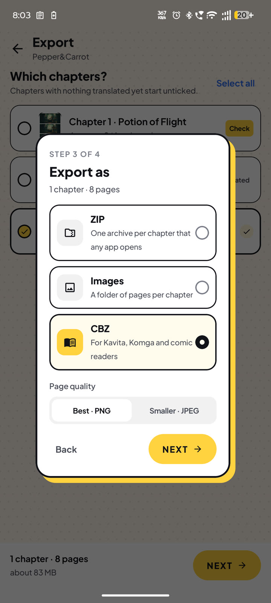
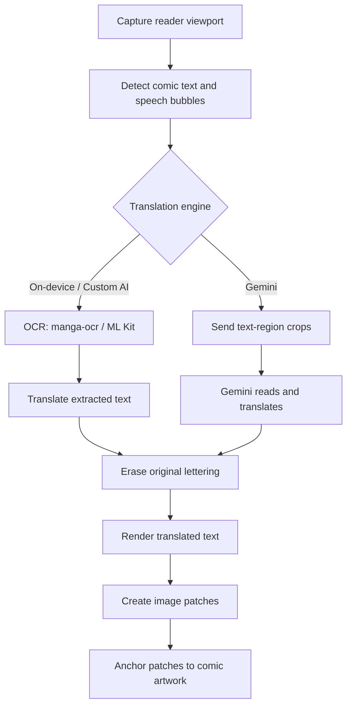

<p align="center">
  
</p>

<h1 align="center">Panelglass – AI Manga, Manhwa &amp; Webtoon Translator for Android</h1>

<p align="center">
  <strong>Read manga, manhwa, manhua and webtoons in your language. Translate comic pages in real time, directly inside
  the reader, with AI-powered translation – even offline.</strong>
</p>

<p align="center">
  <a href="https://github.com/smnexstudio/Panelglass/releases/latest"></a>
  <a href="https://github.com/smnexstudio/Panelglass/stargazers"></a>
  <a href="https://github.com/smnexstudio/Panelglass/blob/main/LICENSE"></a>
  <a href="https://github.com/smnexstudio/Panelglass"></a>
</p>

<p align="center">
  <a href="https://github.com/smnexstudio/Panelglass/releases/latest">Download APK</a> ·
  <a href="#features">Features</a> ·
  <a href="#translation-engines">AI Engines</a> ·
  <a href="#studio-translate-your-own-manga">Studio</a> ·
  <a href="#getting-started">Getting Started</a> ·
  <a href="#privacy--security">Privacy</a> ·
  <a href="#roadmap">Roadmap</a>
</p>

---

Panelglass is a free, open-source **Android manga translator** that uses OCR, AI and image processing to translate
raw Japanese manga, Korean manhwa and Chinese manhua. It replaces the original speech bubbles, captions and sound
effects with translated text while preserving the original artwork and page layout.

Unlike traditional screen translators that display floating translation boxes, Panelglass **erases the original
lettering and redraws the translation directly inside the comic artwork**.

It also includes a built-in **Studio** for translating your own manga chapters, editing individual speech bubbles,
customizing lettering and exporting translated comics.

<p align="center">
  
  <br>
  <sub>Real time, on a phone, fully offline (Gemma 4 E2B): the bubbles are redrawn in English as the model finishes them.<br>
  <a href="docs/ScreenRecordings/translate-peppercarrot.mp4">Watch the full recording</a> (70 s, real speed).</sub>
</p>

## Why Panelglass?

Most manga translation tools either require downloading comic pages separately or display translated text in
floating overlays. Panelglass takes a different approach.

- **Translate while reading:** translate manga and manhwa directly as you scroll through the reader sites you use.
- **Natural in-place translation:** remove the original text and redraw the translation inside speech bubbles and
  captions.
- **Offline AI translation:** use on-device models without sending comic pages to cloud services.
- **Multiple translation engines:** choose between Google ML Kit, Qwen, Gemma, Gemini or a custom AI provider.
- **Built-in manga Studio:** translate, proofread, edit and export your own comic chapters.
- **Privacy-focused:** no Panelglass backend or account. Your API keys are encrypted on your device.

## Screenshots

<table>
  <tr>
    <td align="center"></td>
    <td align="center"></td>
  </tr>
  <tr>
    <td align="center"><sub>Before: the Japanese page, as the site serves it</sub></td>
    <td align="center"><sub>After: translated into English, fully on device (Gemma 4 E2B)</sub></td>
  </tr>
</table>

<table>
  <tr>
    <td align="center"></td>
    <td align="center"></td>
    <td align="center"></td>
    <td align="center"></td>
  </tr>
  <tr>
    <td align="center"><sub>Every bubble found and numbered</sub></td>
    <td align="center"><sub>Check each translation</sub></td>
    <td align="center"><sub>Restyle the lettering</sub></td>
    <td align="center"><sub>Export as images, ZIP or CBZ</sub></td>
  </tr>
</table>

<p>
  <sub>The comic in these captures is <a href="https://www.peppercarrot.com">Pepper&amp;Carrot</a> by David Revoy,
  in its Japanese translation by guruguru: Episode 3 "The Secret Ingredients" read on the Pepper&amp;Carrot site,
  and Episodes 1–3 imported into the Studio as CBZ files. It is published under
  <a href="https://creativecommons.org/licenses/by/4.0/">CC BY 4.0</a>; the English lettering is Panelglass's
  machine translation, not the official English edition.</sub>
</p>

## Features

### 1. Real-time manga and manhwa translation

- Translate raw manga, manhwa, manhua and webtoon pages directly in the built-in browser.
- Automatically detect speech bubbles, captions and sound effects on the comic images.
- Erase the original lettering and replace it with translated text.
- Preserve the original artwork and comic layout.
- Keep translated regions aligned with their original positions while scrolling and zooming.
- Detect page changes in both scrolling and paginated readers.
- Handle dynamically loaded comic pages.
- Re-translate the current screen whenever needed.
- Translate a whole chapter at once with ⋮ › *Translate whole page*.
- Translate pages while browsing, without downloading individual images.
- Translate the site's own text too (titles, chapter lists, comments) with ⋮ › *Translate page*, on the device.

### 2. Advanced manga OCR and text detection

Panelglass combines specialized computer vision and OCR components to identify comic text.

- RT-DETR-v2 based comic text and bubble detection.
- PP-OCRv6 secondary text detection for missed lettering and brush-lettered sound effects.
- Japanese vertical text recognition.
- Optional manga-ocr model for Japanese manga.
- Google ML Kit text recognition.
- Automatic source-language detection (Japanese, Korean, Chinese).

### 3. Multiple AI translation engines

Choose the engine that best fits your device, privacy requirements and quality preferences. See
[Translation engines](#translation-engines).

### 4. Translation customization

Make translations more consistent and natural ([more](docs/TRANSLATION_QUALITY.md)).

- **Glossary:** define character names and preferred spellings per series.
- **Pronouns:** give characters a pronoun (*he*, *she*, *they*); Japanese and Korean leave subjects out.
- **Translation notes:** customize tone, honorifics, terminology and translation behaviour.
- **Sound effects:** keep the original sound effects or replace them with translations.
- **Fonts:** choose from 21 bundled lettering fonts or import your own.
- **Translation testing:** check an engine with *Try a translation* before reading a whole chapter.

### 5. Built-in ad and pop-up blocker

Enjoy a cleaner reading experience.

- Public filter lists fetched at runtime: AdGuard DNS and HaGeZi pop-up ads (StevenBlack as a fallback).
- Native pop-up and pop-under blocking.
- Protection against unwanted redirects and tap-hijacking overlays.
- Site-specific reading preferences: languages, auto-translate and ad blocking per site.

### 6. Languages

**Source:** Japanese, Korean, Chinese (Simplified), Chinese (Traditional), English, Spanish, French, German, Italian,
Portuguese, Russian, Indonesian, Vietnamese.

**Target:** all source languages, plus Thai, Arabic and Hindi.

The app interface is available in 16 languages, including Arabic with a right-to-left layout (English by default;
Settings › Appearance & language).

### 7. And more

- Four themes.
- Back up your sites, glossaries and notes to a file, and restore them on another phone (Settings › Backup & restore).
- Updates itself: a newer release is offered once a day, downloaded, checked against its published SHA-256 and handed
  to Android's installer.
- Works on phones, tablets and Chromebooks.

## Translation Engines

Panelglass supports cloud-based and on-device translation engines.

| Engine | Processing | Internet | Requirements |
|---|---|---|---|
| **Google Translate (ML Kit)** | On-device | No, after language packs download | Language packs (~30 MB each) |
| **Qwen 2.5 1.5B** | On-device AI | No, after model download | ~1.6 GB model |
| **Gemma 4 E2B** | On-device AI | No, after model download | ~2.6 GB model, 8 GB RAM |
| **Gemini** | Cloud AI | Yes | Your own API key |
| **Custom AI** | Your configured server | Yes | OpenAI-compatible API and your own key |

**Google Translate (ML Kit)**
- Free, on-device translation, no API key.
- Japanese, Korean and Chinese packs download at first start; other languages download with one tap when you need them.
- Suitable for lightweight translation.

**Qwen 2.5 1.5B**
- Runs an LLM directly on your Android device, powered by LiteRT-LM.
- GPU acceleration when supported; runs on the CPU on phones under 6 GB of RAM (slower, far less memory).

**Gemma 4 E2B**
- On-device AI translation, powered by LiteRT-LM, GPU acceleration when available.
- Higher-quality offline translation on phones with 8 GB of RAM.

**Google Gemini**
- Cloud-based AI translation that reads and translates the comic text from image crops itself, so no on-device OCR
  is needed.
- Uses your own [Google AI Studio](https://aistudio.google.com/apikey) API key; pick any Gemini or Gemma model your key
  can use.

**Custom AI**

Connect your preferred OpenAI-compatible provider or self-hosted inference server. Presets fill in the address for
**GPT (OpenAI)**, **DeepSeek**, **Grok**, **Claude** and **OpenRouter**; **Custom** takes any other HTTPS endpoint.
You set the API key and model. Only text (read on the device) is sent, never images.

## Studio: Translate Your Own Manga

Panelglass is more than a real-time screen translator. The built-in Studio lets you import your own comic files,
translate entire chapters, edit speech bubbles and export lettered pages. It uses the reader's detector, OCR and
engines, so it runs fully offline too.

### Supported import formats

- Individual images.
- PDF documents.
- CBZ and ZIP archives.
- CB7 and 7z archives.

A ComicInfo.xml fills in the title, number and credits; an archive with a folder per chapter imports as several
chapters, and a pack of several series as one manga per series. RAR (`.cbr`) is not supported yet.

### Translation and editing

- Automatically detect speech bubbles and text regions.
- Translate entire chapters with your selected engine.
- Process chapters in the background, with Pause, Resume and Cancel; runs wait while the phone is hot or low on
  battery.
- Review translations bubble by bubble, and correct the original and translated text.
- Re-translate individual bubbles.
- Add missing text regions manually, and remove incorrect detections.
- Compare the original, cleaned and final pages.
- Undo and redo every edit.

### Advanced manga lettering

- 21 bundled fonts, with a dialogue and a sound-effect default for every target language.
- Import your own TTF, OTF and TTC fonts.
- Adjust font size, weight, italic style and colour.
- Customize text outlines, fills, borders and rounded corners.
- Move, rotate, stretch and bend sound effects.
- Speech balloons are traced to their real shape for natural text placement.
- Clean remaining lettering with brush tools; LaMa inpainting (an optional 208 MB download) rebuilds the art under it.

### Export options

| Export | Description |
|---|---|
| Images | Individual translated pages |
| CBZ | Comic chapters for compatible readers |
| ZIP | Translated pages as an archive |
| Clean pages | Pages with the original lettering removed, to letter elsewhere |

Exports include ComicInfo.xml metadata and a cover, so comic library apps such as Kavita, Komga and Mihon pick up the
details.

## How Panelglass Works

Panelglass combines computer vision, OCR, machine translation, image processing and Android rendering.



1. **Screen capture:** capture the reader viewport with PixelCopy; only the page's comic images are considered.
2. **Detection:** find speech bubbles and text regions (RT-DETR-v2, plus PP-OCRv6 for missed text).
3. **OCR:** read the original text on the device, or send image crops to Gemini.
4. **Translation:** translate the text with the selected engine.
5. **Text removal:** erase the original lettering.
6. **Typesetting:** fit the translation into the original speech bubble or caption.
7. **Rendering:** create image patches and anchor them to their comic pages.

Translations stay aligned with the artwork while scrolling or zooming; rotating the device translates the new layout.
*Translate whole page* runs the same steps at every stop of an automatic scroll, with 30% overlap between screens so
no bubble is cut in two. Details: [docs/FLOW.md](docs/FLOW.md).

## Getting Started

### Download Panelglass

Panelglass is distributed through GitHub Releases and is not available on Google Play.

<p align="center">
  <a href="https://github.com/smnexstudio/Panelglass/releases/latest"></a>
</p>

Requirements:

- Android 12 or later (API 31+).
- About 275 MB for the app.
- Additional storage for downloaded AI models and language packs.

### Installation

1. Visit the [latest release](https://github.com/smnexstudio/Panelglass/releases/latest).
2. Download `panelglass-<version>.apk`.
3. Optionally verify it against the `.sha256` file next to it
   (`sha256sum -c panelglass-<version>.apk.sha256`, or `certutil -hashfile <apk> SHA256` on Windows).
4. Install the APK on your device (allow your browser or file manager to install unknown apps when Android asks).
5. Open Panelglass. The first start lists the models and language packs it suggests and asks whether to download them
   on Wi-Fi only.

Later updates are offered in the app (**Update** or **Later**); Settings › About & updates checks on demand.

### Configure translation

1. Open **Settings › Languages & notes** and choose your source and target languages.
2. Open **Settings › Engine & keys** and select your translation engine.
3. For Gemini or Custom AI, tap **Set key**, paste your API key and choose a model.
4. For Qwen or Gemma, download the model from its row (or Settings › Models & downloads).
5. Check the setup with **Try a translation**.
6. Add your manga website under **Sites**.
7. Open a chapter and press **Start** to translate as you scroll, or choose ⋮ › **Translate whole page** to translate
   the whole chapter at once.

For offline Japanese manga translation, also download **Japanese manga OCR** (140 MB).

### Translate your own manga

1. Open the **Studio** tab.
2. Import images, a PDF or a supported comic archive.
3. Select the chapter and start the translation.
4. Review and correct the detected speech bubbles.
5. Customize the lettering and sound effects.
6. Export the chapter as images, CBZ or ZIP.

## Privacy & Security

- No Panelglass account and no Panelglass backend server.
- API keys are encrypted with the Android Keystore (AES-GCM) and never logged.
- On-device engines keep translation on your phone.
- **Gemini** sends crops of the comic text to Google's API.
- **Custom AI** sends the extracted text to the provider you configured, never images.
- Every connection is HTTPS; nothing is sent in clear text.
- Logs contain no API keys, page URLs or page text.
- Imported Studio files stay in the app's private storage.

Your choice of engine decides where translation happens. Read the full [Privacy Policy](PRIVACY.md), also in the app
under Settings › About & updates › Privacy.

## Technology Stack

| Component | Technology |
|---|---|
| Language | Kotlin |
| UI | Jetpack Compose |
| Database | Room |
| Preferences | DataStore |
| Dependency injection | Hilt |
| On-device LLMs | LiteRT-LM |
| Text detection | RT-DETR-v2, PP-OCRv6 |
| OCR | ML Kit, manga-ocr |
| Model execution | ONNX Runtime |
| Translation | Gemini, ML Kit, Qwen, Gemma, Custom AI |

## Build from Source

Requirements: **JDK 21** (Gradle finds it through `gradle/gradle-daemon-jvm.properties`; AGP 8.x does not run on
newer JDKs), Android SDK Platform 35, Android Studio recommended.

```bash
git clone https://github.com/smnexstudio/Panelglass.git
cd Panelglass
echo "sdk.dir=/path/to/Android/Sdk" > local.properties   # Android Studio writes this for you
./gradlew assembleDebug
adb install -r app/build/outputs/apk/debug/panelglass-*-debug.apk
```

Debug builds install beside the release app as "Panelglass Debug". Unit tests:
`./gradlew testDebugUnitTest :core:model:test`. See [CONTRIBUTING.md](CONTRIBUTING.md) for development guidelines.

## Documentation

| Document | Description |
|---|---|
| [Documentation map](docs/README.md) | Where to start for any question |
| [Architecture](docs/ARCHITECTURE.md) | Modules, components, engines, storage, security model |
| [Translation Flow](docs/FLOW.md) | From screen capture to rendered translation; diagnostics |
| [Detection & OCR](docs/DETECTION_AND_OCR.md) | Text detection, recognition and regions |
| [Translation Quality](docs/TRANSLATION_QUALITY.md) | Engines, glossary, pronouns, notes, sound effects |
| [Memory Usage](docs/MEMORY_USAGE.md) | RAM per engine on a phone |
| [Testing](docs/TESTING.md) | Test coverage and checks on a phone |
| [Contributing](CONTRIBUTING.md) | Contribution guidelines |
| [Changelog](CHANGELOG.md) | Release history |

## Roadmap

Pick an item, open an issue to say you are on it, and follow [CONTRIBUTING.md](CONTRIBUTING.md). Items marked
**good first issue** need little context.

### Engines

- [ ] **OpenRouter** (`llm/OpenRouterEngine`): verify on a device; model dropdown from `/api/v1/models`.
- [ ] **DeepL** (`mt/DeepLEngine`): verify the free and pro hosts, and glossary context.

These exist as `@PlannedEngine` placeholders: request formats are unit-tested, but none has run against the real
service. To offer one, finish its checks, set `offered = true` on its `EngineId`, remove `@PlannedEngine`, and add a
model list if the provider hosts several (see `GeminiEngine.listModels`). OpenAI, DeepSeek and other
OpenAI-compatible providers need no engine of their own: **Custom AI** reaches them at their own address.

### Quality and performance

- [ ] Gemini mode: recover text the detector misses (a cheap backstop or a second-pass prompt).

### App

- [ ] Native-speaker review of the UI translations (`core/ui/src/main/res/values-*`). **good first issue**
- [ ] Accessibility pass: content descriptions, touch targets, contrast in every theme. **good first issue**

## Frequently Asked Questions

<details>
<summary>Is Panelglass free?</summary>

Yes. Panelglass is open source and distributed through GitHub Releases. Some translation providers may charge for API
usage.

</details>

<details>
<summary>Can I translate manga offline?</summary>

Yes. Google ML Kit, Qwen 2.5 and Gemma 4 translate on the device. Download the language packs or AI models
beforehand.

</details>

<details>
<summary>Does Panelglass support Japanese manga?</summary>

Yes. Panelglass supports Japanese, Korean and Chinese comics, including vertical Japanese text.

</details>

<details>
<summary>Does it work with existing manga reader websites?</summary>

Panelglass translates the visible comic content in its built-in browser instead of downloading individual comic
images. No sites ship with the app: you add the reader websites you use.

</details>

<details>
<summary>Does Panelglass require an API key?</summary>

No. Google ML Kit and the on-device AI models need no API key. Gemini and Custom AI need your own provider key.

</details>

<details>
<summary>Can I translate downloaded CBZ chapters?</summary>

Yes. Import CBZ, ZIP, CB7, 7z, PDF or individual images in the Studio, then translate and export your chapters.

</details>

<details>
<summary>Does Panelglass upload my manga pages?</summary>

On-device engines process everything locally. Gemini receives image crops of the text, while Custom AI receives
extracted text only. See the [Privacy Policy](PRIVACY.md).

</details>

<details>
<summary>Can I use my own AI model or server?</summary>

Yes. Custom AI works with any OpenAI-compatible HTTPS endpoint, so you can use your own provider or inference server.

</details>

## Contributing

Contributions, bug reports, feature requests and suggestions are welcome.

1. Look through the existing [issues](https://github.com/smnexstudio/Panelglass/issues) and the [Roadmap](#roadmap).
2. Read the [Contributing Guidelines](CONTRIBUTING.md).
3. Fork the repository and create a feature branch.
4. Submit a pull request.

Found a bug? Please [open an issue](https://github.com/smnexstudio/Panelglass/issues/new).

## Acknowledgements

- Comic text and bubble detector by [ogkalu](https://huggingface.co/ogkalu) (RT-DETR-v2, Apache-2.0).
- Second-pass text detector [PP-OCRv6 tiny](https://huggingface.co/PaddlePaddle/PP-OCRv6_tiny_det_onnx) by
  PaddlePaddle (Apache-2.0).
- [manga-ocr](https://github.com/kha-white/manga-ocr) by kha-white, via the
  [l0wgear/manga-ocr-2025-onnx](https://huggingface.co/l0wgear/manga-ocr-2025-onnx) export.
- [Qwen2.5-1.5B-Instruct](https://huggingface.co/litert-community/Qwen2.5-1.5B-Instruct) (Alibaba, Apache-2.0) and
  [Gemma 4 E2B](https://huggingface.co/litert-community/gemma-4-E2B-it-litert-lm) (Google), LiteRT-LM builds by
  litert-community, run with [LiteRT-LM](https://github.com/google-ai-edge/LiteRT-LM).
- [LaMa](https://github.com/advimman/lama) inpainting for the Studio's cleanup, via the
  [Carve/LaMa-ONNX](https://huggingface.co/Carve/LaMa-ONNX) export (Apache-2.0).
- [ONNX Runtime](https://onnxruntime.ai) and [ML Kit](https://developers.google.com/ml-kit) text recognition and
  translation.
- Block lists by [AdGuard](https://github.com/AdguardTeam/AdGuardSDNSFilter), [HaGeZi](https://github.com/hagezi/dns-blocklists)
  and [StevenBlack](https://github.com/StevenBlack/hosts).
- Lettering fonts, bundled with their licences (full copyright statements in [NOTICE](NOTICE)):
  - SIL Open Font License 1.1: Plus Jakarta Sans (Tokotype), Comic Neue (Craig Rozynski), Bangers,
    Shantell Sans (Arrow Type), Rubik Mono One (Hubert & Fischer), Zen Antique, Dela Gothic One, Gaegu,
    Black Han Sans (Zess Type), ZCOOL KuaiLe, Smiley Sans 得意黑 (atelierAnchor), jf open 粉圓 (justfont),
    Itim and Kanit (Cadson Demak), Reem Kufi Fun (Aliftype), Lalezar (Borna Izadpanah), Kalam (Indian Type
    Foundry) and Baloo 2 (Ek Type).
  - Apache-2.0: Coming Soon (Open Window) and Luckiest Guy (Astigmatic).

Model files keep their own licences; check each model card before redistributing them.

## Disclaimer

Panelglass is a reading aid. It ships with no content and no site list. Respect the terms of the sites you visit and
the rights of creators and publishers, and support official releases where they exist.

## License

Copyright 2026 smnexstudio. Panelglass is licensed under the [Apache License 2.0](LICENSE).

The licence covers the Panelglass source code and documentation. Third-party files in this repository (the two
detector models and the fonts) keep their own licences; see [LICENSES.md](LICENSES.md) and [NOTICE](NOTICE).
Downloaded models keep theirs.

---

<p align="center">
  <b>Enjoy reading manga in your language.</b>
  <br>
  Translate smarter. Read freely. Keep the original artwork.
  <br><br>
  <a href="https://github.com/smnexstudio/Panelglass">GitHub Repository</a> ·
  <a href="https://github.com/smnexstudio/Panelglass/releases/latest">Download Panelglass</a> ·
  <a href="https://github.com/smnexstudio/Panelglass/issues">Report an Issue</a>
</p>

<!--
SEO keywords:
manga translator android, manhwa translator, manhua translator,
webtoon translator, offline manga translator, AI manga translator,
Japanese manga OCR, Korean manhwa translation, comic translator,
manga image translator, CBZ translator, manga lettering,
on-device AI translation, manga OCR Android, raw manga translator.
-->
