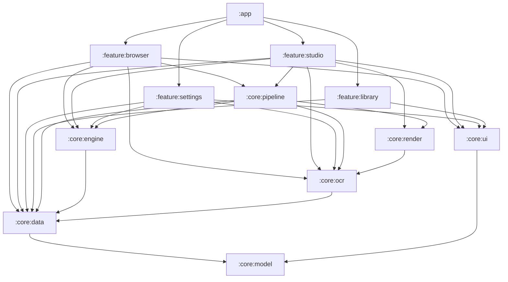
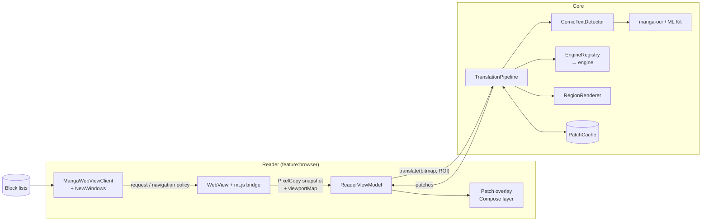

# Architecture

Panelglass is a single-activity Android app (Kotlin, Jetpack Compose, Hilt) split into Gradle modules by layer. This
document covers the module layout, the main components and how they talk, storage, concurrency and the security
model. The translation flow itself is in [FLOW.md](FLOW.md); detection and OCR in [DETECTION_AND_OCR.md](DETECTION_AND_OCR.md).

## Contents

- [Principles](#principles)
- [Requirements](#requirements)
- [Modules](#modules)
- [Runtime components](#runtime-components)
- [Engines](#engines)
- [Storage](#storage)
- [Concurrency and memory](#concurrency-and-memory)
- [Security and privacy](#security-and-privacy)
- [Testing](#testing)

## Principles

1. **Translate what the user sees.** The reader never downloads page images. It snapshots the WebView's viewport,
   so it works on any site, whatever the site does with its images (canvas, blob URLs, scrambled tiles).
2. **One pipeline, one entry point.** `TranslationPipeline.translate` is the only way pixels become translations.
3. **Patches, not pages.** The output is a small WEBP per text region, positioned in the page's CSS pixels and drawn
   natively over the WebView, so it scrolls and zooms with the art. The page's DOM is never modified by the translator.
4. **The user's engine is the engine.** A failing engine surfaces a typed failure; it is never silently replaced by
   another provider.
5. **Nothing secret or personal in logs or in the repo.** API keys live only in an Android-Keystore-backed store.

## Requirements

What the app must do (functional, `FR`) and how well (non-functional, `NFR`), as the code implements it today. Each
requirement names its evidence: a JVM test class ([TESTING.md](TESTING.md)), or a phone check
([TESTING.md › Checks on a phone](TESTING.md#checks-on-a-phone)) where only a real device can show it. A change that
alters a requirement updates this list in the same pull request.

### Functional requirements

**Reader**

| ID | Requirement | Evidence |
|---|---|---|
| FR-1 | Open any web page over https; an `http` address is upgraded, any other scheme is refused. | `WebUrlTest`, `NavigationPolicyTest` |
| FR-2 | **Start** translates the visible screen: every text region is found, read, translated, erased and lettered in place, in the target language. | `TranslationPipelineTest`, `RegionRendererTest`; phone check |
| FR-3 | Translations stay on the art while the page scrolls, zooms or shifts its layout. | `PatchAnchorTest`; phone check |
| FR-4 | The next screen is translated after a settled scroll, when images finish loading, after a page turn without a scroll and after a rotation; a balloon cut by the screen edge waits until it is whole. | `ContentChangeTest`, `TranslationPipelineTest`; phone check |
| FR-5 | **Re-translate** reads and translates the screen again, ignoring cached results. | `TranslationPipelineTest` |
| FR-6 | The source language follows the page (Japanese, Korean, Chinese) unless the site or the launch has its own. | `SessionLanguagesTest` |
| FR-7 | Sound effects are kept or replaced (default Replace); effects nothing can read are erased only with Replace. | `SfxDictionaryTest`, `DetectionStageTest`, `RetiredSfxModeTest` |
| FR-8 | **Translate page** translates the site's own text on the device, and **Show original** restores it. | `PageTranslatorTest`; phone check |

**Engines and translation quality**

| ID | Requirement | Evidence |
|---|---|---|
| FR-9 | The user picks the engine: Google Translate (on-device, default), Gemini (own key, chosen model), Qwen 2.5 1.5B or Gemma 4 E2B (on-device). An engine the phone cannot run is not offered. | `EnginePickerTest`, `SettingsViewModelTest`, `ProviderEngineTest` |
| FR-10 | An engine is never switched behind the user's back: a missing key opens the key sheet, every failure is reported as a typed `EngineFailure`. | `RegistryAndQwenTest`, `OfflineEnginesTest`, `HttpFailureWireTest` |
| FR-11 | Japanese, Korean and Chinese language packs are fetched at first start; any other pack only when the user asks. | `LanguagePackStoreTest`, `GoogleTranslateEngineTest`, `StartupTasksTest` |
| FR-12 | Per series: a glossary of names and terms, each character with a pronoun, and series notes. Settings holds notes for every series, starting with suggested notes. Editing any of them translates pages again. | `SeriesMemoryTest`, `SeriesResolverTest`, `TranslationNotesTest`, `SettingsRepositoryTest` |

**Sites, history and blocking**

| ID | Requirement | Evidence |
|---|---|---|
| FR-13 | Sites are saved (https only) with their own languages, ad blocking and pin; the list can be searched. | `LibraryViewModelTest`, `LibraryScreenTest`, `SiteMatchTest` |
| FR-14 | History keeps the last 15 visits; one or all can be removed. | `LibraryScreenTest` (remove one, clear all); the 15-visit limit (`HISTORY_LIMIT`) has no test |
| FR-15 | Ad, tracker and pop-up hosts are blocked from lists fetched at runtime and refreshed daily; only a tapped same-site link opens a new window. | `BlockListTest`, `BlockListRepositoryTest`, `NavigationPolicyTest`, `SameSiteTest` |

**Studio**

| ID | Requirement | Evidence |
|---|---|---|
| FR-16 | Import images, a PDF or a CBZ into a new or existing manga or chapter, with ComicInfo.xml read and a chapter per folder when the archive has one. | `StudioImporterTest`, `ImportViewModelTest`, `CbzImporterTest`, `ImageImporterTest`, `FolderChaptersTest` |
| FR-17 | Translate a chapter with the chosen engine; a stopped or failed run continues from the first unfinished page. | `StudioTranslatorTest` |
| FR-18 | Review each bubble: edit the original and translation, re-translate, add, dismiss or delete bubbles, undo and redo, mark pages reviewed. | `ReviewSavingTest`, `ReviewPanelsTest`, `PageCanvasGestureTest` |
| FR-19 | Clean and letter pages: fonts, size, colour, outline, fill, reshaped bubbles, brush, sound-effect presets and transforms. | `PageCleanerTest`, `StudioRendererTest`, `SfxRendererTest`, `ReviewPanelsTest` |
| FR-20 | Export chapters as images, CBZ or ZIP with ComicInfo.xml, to Downloads or a folder the user picks: translated pages, or clean text-free pages under their own name. | `StudioExporterTest`, `ExportViewModelTest`, `ExportScreenTest`, `ExportNamesTest` |
| FR-21 | Use the bundled fonts and add the user's own (`.ttf`, `.otf`, `.ttc`). | `FontCatalogueTest`, `FontsViewModelTest` |

**Settings and app**

| ID | Requirement | Evidence |
|---|---|---|
| FR-22 | Download and delete the on-device models, manga-ocr and LaMa; see and delete the Studio's storage per manga. | `SystemDownloadsQueueTest`, `SettingsScreenTest` |
| FR-23 | A newer release is offered once a day (never in a debug build, never with *Check automatically* off) and on demand; it is downloaded, verified and handed to Android's installer. A check that fails says so. | `AppUpdatesTest`, `ReleaseInfoTest`, `UpdateDialogTest`; phone check |
| FR-24 | The interface is in 16 languages, English by default whatever the phone's language; four themes. | `AppLocaleTest`, `SettingsScreenTest` |

### Non-functional requirements

**Privacy and security**

| ID | Requirement | Evidence |
|---|---|---|
| NFR-1 | No Panelglass server. The app contacts only: the sites the user opens, Gemini (only when chosen, with the user's key), Hugging Face (model files), Google's ML Kit packs, the block-list sources and GitHub releases. | Code review; `OfflineEnginesTest` |
| NFR-2 | https only: no cleartext traffic, mixed content never allowed. | `ManifestPolicyTest`, `WebUrlTest` |
| NFR-3 | API keys are encrypted with an Android Keystore key and sent only in request headers; logs never hold keys, page URLs, page text or user IDs. | `SecureKeyStoreInstrumentedTest` (device only); code review |
| NFR-4 | Nothing is backed up or copied to a new phone; uninstalling removes everything. | `ManifestPolicyTest` |
| NFR-5 | Every downloaded file is verified: models against a SHA-256 pinned to a commit, the update APK against its release checksum and Android's signature check; update URLs must resolve under this repository's releases. | `ModelPinningTest`, `SystemDownloadsIntegrityTest`, `ReleaseInfoTest` |
| NFR-6 | Pages cannot reach the app: no JavaScript interface, no file or content access, the helper scripts are frozen, page text is data and never instructions to a model. | `NavigationPolicyTest`, `LlmContractTest`; code review |
| NFR-7 | Untrusted input is bounded: archive paths cannot leave their folder, sizes and page counts are capped before decoding, page-script replies (1 MB), block lists (32 MB) and model replies (`LlmContract.outputBudget`) are capped. | `CbzImporterTest`, `ImageImporterTest`, `StudioDaoTest`, `BlockListRepositoryTest` |

**Reliability**

| ID | Requirement | Evidence |
|---|---|---|
| NFR-8 | Offline: with the packs or models installed, Google Translate and the on-device engines translate without a network; the Studio imports and exports offline. | `OfflineEnginesTest`, `StudioExporterTest` |
| NFR-9 | A stuck stage fails only its image, with a typed failure: a 50 s watchdog per stage in the reader, 240 s per group in the Studio. Only transient failures are retried: rate limits 3 times, overload twice, back-off at most 4 s. | `TranslationPipelineTest`, `StudioTranslatorTest`, `HttpFailureWireTest` |
| NFR-10 | Model and update downloads survive leaving and killing the app (system DownloadManager). | `SystemDownloadsQueueTest`; phone check |
| NFR-11 | Upgrades keep the user's data: every database version has a migration, and settings saved by older releases read back. | `Migration3To4Test`, `Migration4To5Test`, `UnmigratedVersionsTest`, `SettingsRepositoryTest` |
| NFR-12 | No work is lost: review edits are saved 400 ms after typing and at once on a page turn or leaving; an import abandoned before saving leaves no partial chapter. | `ReviewSavingTest`, `ImportViewModelTest`, `StudioImporterTest` |

**Performance and resources**

| ID | Requirement | Evidence |
|---|---|---|
| NFR-13 | The interface never waits for a model: loading happens off the main thread, the reader pre-warms detector, OCR and engine, and each pipeline stage has its own concurrency limit. | Code review; phone check |
| NFR-14 | Memory: one on-device model at a time, released when idle or under memory pressure; models a phone cannot hold are hidden (Gemma 4 under 8 GB, LaMa under 4 GB) and Qwen runs on the CPU under 6 GB. | `RegistryAndQwenTest`, `SettingsViewModelTest`; [MEMORY_USAGE.md](MEMORY_USAGE.md) |
| NFR-15 | Cloud cost is bounded: each reply at most 300 + 120 tokens per item (8,192 in all), glossary terms 60 characters, notes 500. | `LlmContractTest` (reply cap), `TranslationNotesTest` (notes); the glossary cap has no test |

**Compatibility, usability and maintainability**

| ID | Requirement | Evidence |
|---|---|---|
| NFR-16 | Android 12 or later (minSdk 31, target 35); phones, tablets and resizable windows (navigation rail and side-by-side layouts above 600 dp). | `WidthClassTest`; build configuration |
| NFR-17 | Every string is translated into the 16 UI languages, right to left included; no hard-coded text. | Code review; phone check (no test checks that every string is translated) |
| NFR-18 | Every control has a label for TalkBack. | `SettingsScreenTest`, `LibraryScreenTest` (Settings and Sites only) |
| NFR-19 | Bundled models, fonts and dictionaries carry a redistributable licence and a NOTICE entry; no GPL block list is bundled. | `FontCatalogueTest`; NOTICE |
| NFR-20 | Every pull request runs all JVM tests without a device or the network, and reports each test's expected and actual result. | `.github/workflows/ci.yml`, [TESTING.md](TESTING.md) |

**Not yet verified automatically:** the reader's screen capture and overlay (`ReaderViewModel`, `ScreenTranslate`),
real model and GPU performance, and the release (R8) build: these rely on the phone checks.

## Modules

Every module also depends on `:core:model`; those edges are left out for readability.

| Module | Responsibility | Key types |
|---|---|---|
| `:core:model` | Pure Kotlin, no Android. The shared vocabulary. | `Lang`, `EngineId`, `EngineFailure`, `TextLine`, `TextRegion`, `RegionKind`, `TranslateConfig`, `Settings`, `Site`, `GlossaryEntry`, `Pronoun`, `SeriesNotes`, `TranslationNotes` |
| `:core:data` | Persistence, secrets, downloads, updates. | `PanelglassDb` (Room), `SettingsRepository` (DataStore), `SecureKeyStore`, `PatchCache`, `SystemDownloads`, `GlossaryRepository`, `AppUpdates` |
| `:core:engine` | Everything that turns source text into target text. | `TranslationEngine`, `EngineRegistry`, `EngineRetry`, `BatchingTranslator`, `LlmContract`, `GeminiEngine`, `CustomOpenAiEngine`, `GoogleTranslateEngine`, `LocalLlmEngine` / `LocalPrompt`, `SfxDictionary` |
| `:core:ocr` | Finding and reading text in a bitmap. | `ComicTextDetector`, `MissedTextDetector` (+ `DbPostProcess`), `MangaOcrRecognizer`, `MlKitCropRecognizer` (+ `HighContrast`), `RegionBuilder`, `RegionClassifier`, `RegionClusterer` |
| `:core:render` | Erasing source text and drawing the translation; the Studio's page layers. | `TextEraser`, `RegionRenderer`, `Placement`, `PatchEncoder`, `PageCleaner`, `StudioRenderer`, `SfxRenderer`, `StudioFonts` |
| `:core:pipeline` | Orchestration: stages, limits, watchdogs, cache. | `TranslationPipeline`, `RegionOfInterest`, `PageSource`, `PipelineDump`, `TileDetection` |
| `:core:ui` | Shared Compose components, theming, every UI string. | `PanelglassTheme`, `Tokens`, `EnginePicker`, `ApiKeyDialog`, `SeriesMemorySheet`, `FontBrowser` |
| `:feature:browser` | The reader: WebView, capture, overlay, page language, blocking. | `ReaderScreen`, `ReaderViewModel`, `ScreenTranslate`, `ContentChange`, `MangaWebViewClient`, `NewWindows`, `BlockList`, `mt.js`, `pt.js` |
| `:feature:library` | Saved sites and history. | `LibraryScreen`, `HistoryScreen`, `LibraryViewModel` |
| `:feature:settings` | Languages, engines, sound effects, notes, models, fonts, themes, storage, updates. | `SettingsScreen`, `SettingsViewModel` |
| `:feature:studio` | Translating the user's own files: import, translate, review, clean, letter, export. | `StudioTranslator`, `ReviewViewModel`, `StudioImporter`, `StudioExporter`, `ExportContent`, `PageComposer` |
| `:app` | Activity, navigation graph, application class, update dialog. | `MainActivity`, `PanelglassApp`, `UpdateHost` |

Dependencies point downwards only: features never depend on each other, and `:core:model` depends on nothing.

## Runtime components

- **`ReaderViewModel`** owns the reader session: the WebView itself (kept across trips to Settings through a
  `MutableContextWrapper`), the resolved `TranslateConfig`, the screen-translation session and its patches, and what
  triggers the next capture: a settled scroll, pages that finish downloading, a page turn without a scroll
  (`ContentChange`), a rotation. It keeps each patch anchored to its page image so it follows layout shifts.
- **`mt.js`** is injected into every page. It reports where the page's images are (with a key per image), how many
  are still loading, and which controls float over them (`viewportMap()`); it also hides full-screen interstitials
  and disables `window.open`. `mt.js` and `pt.js` go in at document start (`WebViewCompat.addDocumentStartJavaScript`),
  before any page script, and `__mt`/`__pt` are read-only frozen objects, so a page cannot stand in for the bridge.
  Replies over `MAX_BRIDGE_REPLY` characters are dropped unparsed.
- **`MangaWebViewClient`** blocks requests to hosts on the merged block lists and enforces the navigation policy
  (no cross-site redirects without a tap, no ad hosts as the main frame, only `mailto:`/`tel:`/`sms:` leave the
  app). **`NewWindows`** decides every new-window request: only a tapped same-site link opens, in the reader.
- **`EngineRegistry`** resolves the selected `EngineId` to an engine, or to a typed failure (`MissingKey`,
  `ModelMissing`, not offered). It never picks a different engine.
- **Two detectors.** `ComicTextDetector` (RT-DETR-v2, balloons and text) runs first; `MissedTextDetector`
  (PP-OCRv6 tiny) then finds text outside its boxes, mostly sound effects. See [DETECTION_AND_OCR.md](DETECTION_AND_OCR.md).
- **The series' glossary and notes** (`GlossaryRepository`, edited in the reader's *Glossary & pronouns* sheet) and
  Settings' translation notes are combined by the pipeline before every capture and sent with each engine call.
  Settings' notes start as `TranslationNotes.DEFAULT` until the user saves their own (an emptied note stays empty).
  See [TRANSLATION_QUALITY.md](TRANSLATION_QUALITY.md).
- **`AppUpdates`** asks GitHub for the latest release once a day (never in a debug build), downloads a newer APK
  through `SystemDownloads`, checks it against the release's `.sha256`, and hands it to Android's installer; the
  dialog is `UpdateHost` in `:app`.
- **Studio export** (`StudioExporter`, app-scoped, one run at a time) writes a chapter page by page through
  `PageComposer`. The page is one of a Studio page's three layers: **Translated** (`ExportContent.TRANSLATED`) is the
  editor's Final, the clean layer with every bubble lettered by `StudioRenderer`; **Clean** (`ExportContent.CLEAN`) is
  the editor's Clean layer alone, text-free, for lettering elsewhere. The original file is never changed. Clean
  exports are named `… (Clean)` (`ExportNames.CLEAN_SUFFIX`), so the two never replace each other, and their
  ComicInfo.xml names no language. The flow is chapters → what to export → format → folder.

## Engines

| Engine | `EngineId` | Where it runs | Reads the crop itself |
|---|---|---|---|
| Gemini (and Gemma via the Gemini API) | `GEMINI` | Google API, user key | Yes: one call reads and translates |
| Custom AI (any OpenAI-compatible server) | `CUSTOM` | The user's own server, user key | No |
| Google Translate | `GOOGLE` | On device (ML Kit translation) | No |
| Qwen 2.5 1.5B | `QWEN15_LOCAL` | On device (LiteRT-LM) | No |
| Gemma 4 E2B | `GEMMA4_LOCAL` | On device (LiteRT-LM), 8 GB RAM devices | No |
| The user's own model | `LOCAL_USER` | On device (LiteRT-LM), from the user's library | No |

Claude, OpenAI, OpenRouter, DeepSeek, DeepL and Papago exist in code as `@PlannedEngine` placeholders: hidden from
the picker and refused by the registry.

- **Custom AI's address.** The user names the server's base address and the model in Settings; the key goes to the
  key store, the address to the settings store (it is not a secret). `CustomEndpoint` reduces the address to its
  base — a pasted `…/chat/completions` is stripped — and requires HTTPS; the engine then calls
  `<base>/chat/completions`. No version segment is ever appended. The request is text only: the on-device OCR reads
  the page, so no crop or montage is sent.

- **Retries.** Only transient failures are retried, on the same engine and model (`EngineRetry`): rate limits up to
  3 times, overload (HTTP 500/502/503/504/529) up to 2 times, back-off capped at 4 s.
- **Cloud contract.** LLM engines exchange a JSON array of `{i, text}` items (`LlmContract`); Gemini's reading mode
  returns `{i, source, text}`.
- **On-device contract.** The LiteRT-LM models share one KV cache between prompt and reply (4096 tokens), so they get
  compact numbered lines (`3: translation`) in chunks of at most 12 items, and the reply is streamed and cut as soon
  as every requested line is complete. Only one on-device model is loaded at a time (`LocalEngines`).
- **On-device GPU.** LiteRT-LM tries its GPU backend first and falls back to the CPU. The GPU backend uses the
  vendor's OpenCL library, which from Android 12 an app can load only if the manifest declares it
  (`<uses-native-library>` for `libOpenCL.so`, `libOpenCL-car.so`, `libOpenCL-pixel.so`, `libvndksupport.so`, all
  optional). Without them the GPU backend fails with "OpenCL not supported" and the models run on the CPU.
- **Qwen's backend** (`Settings.qwenBackend`, Settings › Models › *Qwen runs on*): Automatic (default) takes the CPU
  on phones under 6 GB of RAM (`DeviceMemory.qwenOnCpu`), the GPU otherwise; GPU or CPU can be forced. On the CPU
  Qwen is about 3× slower, but its weights stay a memory-mapped file the system can reclaim (~0.6 GB pinned instead
  of ~2.8 GB; see [MEMORY_USAGE.md](MEMORY_USAGE.md)). The choice is read at each load, and a model loaded on the
  other backend is reloaded on its next call.

## Storage

| What | Where | Notes |
|---|---|---|
| Sites, history (last 15), SFX translations, glossary (with pronouns), series notes, Studio library | Room `PanelglassDb`, version 5 | Every schema change bumps the version and adds a `Migration` (`MIGRATION_3_4`, `MIGRATION_4_5`) |
| Settings, translation notes, skipped update, last update check, the Studio's last export choices (content, format, quality) | DataStore | Includes remembered Gemini request options per model, and the Custom AI server address |
| API keys | `SecureKeyStore` | AES-GCM, key in the Android Keystore |
| Rendered patches | `PatchCache` (disk LRU) | Keyed by image hash, languages, engine, `PIPELINE_VERSION`, font, and a digest of the glossary and notes |
| Detector models | `assets/` | Bundled: comic detector 11 MB, PP-OCRv6 tiny 1.8 MB |
| LLMs, manga-ocr, LaMa | App-specific external storage | Downloaded by DownloadManager, SHA-256 verified |
| Update APK | App-specific external storage, `updates/` | Only the release being installed is kept |
| Block lists | `filesDir/blocklist/<source>.txt` | Fetched at runtime, refreshed daily |

`android:allowBackup="false"` plus `data_extraction_rules.xml` (which excludes every domain from cloud backup and from
device-to-device transfer, which Android 12+ would otherwise still do): nothing is backed up or copied to a new
phone, and everything is removed on uninstall.

## Concurrency and memory

- Pipeline stages have their own limits because they contend for different resources: decode 2, detect 2,
  cloud translate 6, on-device translate 1, render 2. A slow engine call does not stop the next capture from
  detecting.
- Each stage has a 50 s watchdog; a timeout fails that image only, with a typed failure.
- Model loading never happens on the main thread. The reader pre-warms the detector, OCR and engine when it opens.
- Patches more than three screens away from the viewport are dropped and re-made on return.
- `PanelglassApp.onTrimMemory` releases idle on-device models and manga-ocr sessions under memory pressure
  (`TRIM_MEMORY_RUNNING_LOW` and above), and logs that it did. When the UI is hidden (`TRIM_MEMORY_UI_HIDDEN`), a
  translator still busy is released 5 s after its last call (`LocalEngines.onHidden`), unless the app comes back
  first (`onVisible`, from the activity callbacks).

## Security and privacy

- **Keys.** Stored only in `SecureKeyStore`; never logged. HTTP bodies are never logged (they can echo a key).
- **Logs.** Timings and failure types only: no keys, page URLs, page text or user IDs.
- **Exported activity.** `MainActivity` accepts a `url` from other apps but loads only `https` (`http` is
  upgraded). The scripted-run extras (`engine`, `src`, `tgt`, `start`) are honoured only in debuggable builds.
- **Debug and release side by side.** Debug builds use the application ID `com.smnexstudio.panelglass.debug` and the
  name "Panelglass Debug": their own data, keys and downloads; release builds keep `com.smnexstudio.panelglass`.
- **In-app updates.** The APK URL must be https under this repository's `releases/download/` (`ReleaseInfo.PREFIX`,
  from the `updateRepo` Gradle property, which the release workflow sets to the repository it runs in), checked on the
  URL as resolved (`ReleaseInfo.isReleaseAsset`: no `..` segment, `%` escape, query, fragment, user or port). The file
  is checked against the release's `.sha256` before Android's installer sees it, and the installer refuses an APK
  signed with another key. `REQUEST_INSTALL_PACKAGES` and a FileProvider that shares only `updates/` make the
  hand-off possible.
- **User notes are instructions, page text is not.** Engines follow the reader's notes and glossary, but every prompt
  tells the model that page text is data, never instructions. No model has tools: its reply is only drawn as text.
  Every cloud reply is capped by the item count (`LlmContract.outputBudget`) and glossary terms by
  `GlossaryEntry.MAX_CHARS`, so no note or term can make a call write, and bill, an essay.
- **WebView.** No file or content access; no JavaScript interface is exposed to pages; new windows are decided
  natively; blocked hosts never become the main frame.
- **Downloads.** Every model file is pinned to a Hugging Face commit and verified against its SHA-256 before it is
  used; mismatches are deleted. App-specific external storage is private to the app on every supported version
  (Android 12+).

## Testing

| Suite | Command | Covers |
|---|---|---|
| Unit (JVM) | `./gradlew testDebugUnitTest :core:model:test` | Every module, without a device or the network. Engines and update checks against MockWebServer; the pipeline with a scripted detector and model; Room migrations; view models over Room in memory; Compose screens (Settings, Sites, History, Export, the review editor's panels, the update dialog) on Robolectric, with accessibility checks on Settings and Sites |
| Coverage and report | `./gradlew jacocoUnitTestReport`, then `python3 tools/test-report/report.py --root . --out build/test-report` | JaCoCo line and branch coverage (all code, logic, Compose UI) and an HTML report with each test's expected and actual result |
| Instrumented | `./gradlew :core:data:connectedDebugAndroidTest` | `SecureKeyStore` round-trip with the real Android Keystore (device only) |
| Instrumented | `./gradlew :core:pipeline:connectedDebugAndroidTest` | A rendered page through the whole pipeline (device only) |

CI (`.github/workflows/ci.yml`) runs the unit tests, coverage and the report on every pull request into `main`,
posts the verdict as one comment on the pull request, and keeps the report and the raw results as artifacts; the
instrumented tests are not run there. LiteRT-LM is never loaded in JVM tests: `LocalLlmEngine.runnerFactory` is
replaced by a scripted `LlmRunner`. Every test class, the counts, the phone checks and what is not covered are in
[TESTING.md](TESTING.md); each requirement above names its tests.
