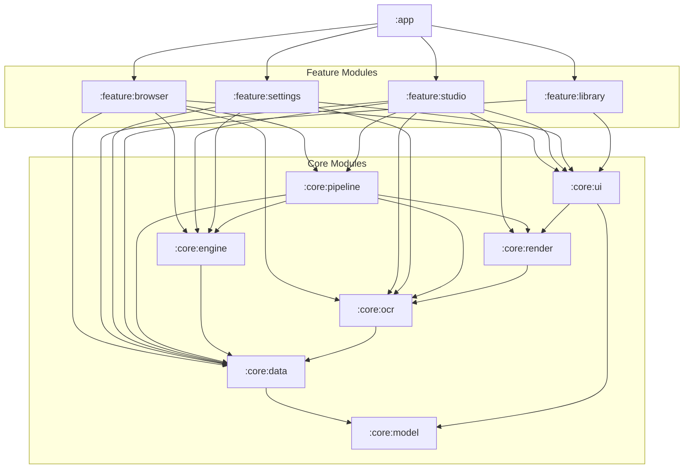
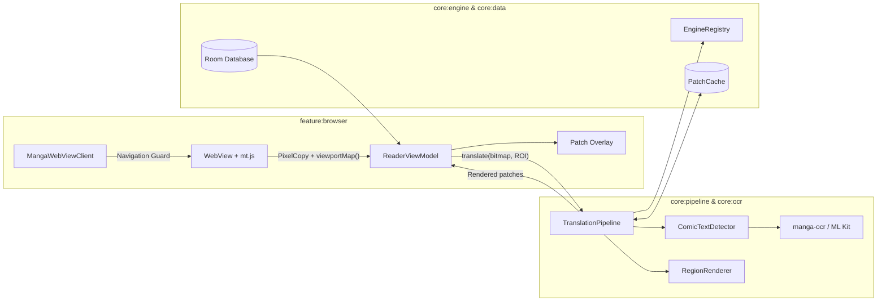

# System Architecture Guide

Panelglass is a single-activity Android application built with Kotlin, Jetpack Compose, and Dagger Hilt. This document specifies the architectural layers, system requirements, runtime components, storage schemas, concurrency models, and security boundaries.

For step-by-step translation execution, see [FLOW.md](FLOW.md). For vision models and OCR pipelines, see [DETECTION_AND_OCR.md](DETECTION_AND_OCR.md).

---

## Contents

- [Architectural Principles](#architectural-principles)
- [System Requirements & Test Traceability](#system-requirements--test-traceability)
  - [Functional Requirements (FR)](#functional-requirements-fr)
  - [Non-Functional Requirements (NFR)](#non-functional-requirements-nfr)
- [Module Topology & Dependency Boundaries](#module-topology--dependency-boundaries)
- [Runtime Component Interactions](#runtime-component-interactions)
- [AI Translation Engine Subsystem](#ai-translation-engine-subsystem)
- [Persistence, Schemas & Backup Architecture](#persistence-schemas--backup-architecture)
- [Concurrency, Watchdogs & Memory Budgets](#concurrency-watchdogs--memory-budgets)
- [Security Model & Sandboxing](#security-model--sandboxing)
- [Verification & Test Suites](#verification--test-suites)

---

## Architectural Principles

1. **Translate the Composited Screen:** Panelglass never scrapes or downloads comic image files behind the reader's back. It snapshots the hardware-accelerated viewport, ensuring compatibility with any comic reader site (canvas rendering, blob URLs, encrypted tiles).
2. **Single Pipeline Entry Point:** Every reader pixel transformation flows through `TranslationPipeline`; the Studio uses its detect and translate halves (`detectStudioPage`, `translateRegions`) and draws with its own renderer.
3. **Native Overlays over DOM Modification:** Translations are rendered as native WebP image patches pinned in page coordinates over the WebView. The webpage's DOM is never manipulated for comic translation.
4. **Deterministic Engine Routing:** An engine never silently falls back to another provider; engine failures surface typed errors (`EngineFailure`).
5. **Zero Secret Leakage:** User API keys are stored exclusively in the Android Keystore-backed encrypted storage and are never logged or exposed.

---

## System Requirements & Test Traceability

Every requirement maps directly to automated unit test evidence ([TESTING.md](TESTING.md)) or manual device verification checks.

### Functional Requirements (FR)

#### 1. Web Reader & Translation
| ID | Functional Requirement | Test / Verification Evidence |
|---|---|---|
| **FR-1** | Open any web page over HTTPS; HTTP schemes are upgraded; all other schemes are blocked. | `WebUrlTest`, `NavigationPolicyTest` |
| **FR-2** | **Start** translates the visible screen: text is detected, read, translated, erased, and lettered in place. | `TranslationPipelineTest`, `RegionRendererTest`; Phone verification |
| **FR-3** | Rendered translations remain anchored to the artwork during scrolling, zooming, and dynamic layout shifts. | `PatchAnchorTest`; Phone verification |
| **FR-4** | Captures trigger automatically after settled scrolling, image download completion, page turns, and device rotation. | `ContentChangeTest`, `TranslationPipelineTest`; Phone verification |
| **FR-5** | **Re-translate** forces a fresh engine translation, bypassing cached patches. | `TranslationPipelineTest` |
| **FR-6** | Source language follows the page language (JA, KO, ZH) unless a site-specific override is configured. | `SessionLanguagesTest` |
| **FR-7** | Sound effects support *Keep* and *Replace* modes; unreadable effects are erased only when Replace is active. | `SfxDictionaryTest`, `DetectionStageTest`, `RetiredSfxModeTest` |
| **FR-8** | **Translate page** translates visible DOM HTML text; **Show original** restores original text. | `PageTranslatorTest`; Phone verification |

#### 2. Translation Engines & Quality
| ID | Functional Requirement | Test / Verification Evidence |
|---|---|---|
| **FR-9** | Engine selection: Google Translate (ML Kit), Gemini (API key), Qwen 2.5 1.5B, or Gemma 4 E2B. Hardware-unsupported engines are hidden. | `EnginePickerTest`, `SettingsViewModelTest`, `ProviderEngineTest` |
| **FR-10** | Missing keys or provider outages return explicit typed `EngineFailure` instances; engines never swap silently. | `RegistryAndQwenTest`, `OfflineEnginesTest`, `HttpFailureWireTest` |
| **FR-11** | CJK language packs are pre-fetched on initial setup; other languages download on demand. | `LanguagePackStoreTest`, `GoogleTranslateEngineTest`, `StartupTasksTest` |
| **FR-12** | Character glossaries, pronoun tracking, and translation notes apply per series and trigger cache invalidation. | `SeriesMemoryTest`, `SeriesResolverTest`, `TranslationNotesTest`, `SettingsRepositoryTest` |

#### 3. Library, Bookmarks & Content Filtering
| ID | Functional Requirement | Test / Verification Evidence |
|---|---|---|
| **FR-13** | Bookmarked sites store HTTPS addresses, custom language pairs, pin states, and ad-blocking rules. | `LibraryViewModelTest`, `LibraryScreenTest`, `SiteMatchTest` |
| **FR-14** | History tracks up to 15 recent visits with single or bulk removal. | `LibraryScreenTest` |
| **FR-15** | Ad, tracker, and popup hosts are blocked via daily-refreshed blocklists. | `BlockListTest`, `BlockListRepositoryTest`, `NavigationPolicyTest`, `SameSiteTest` |

#### 4. Studio (Local Chapters)
| ID | Functional Requirement | Test / Verification Evidence |
|---|---|---|
| **FR-16** | Import comic archives (CBZ, ZIP, 7z, PDF, raw images) with `ComicInfo.xml` metadata extraction. | `StudioImporterTest`, `ImportViewModelTest`, `ArchiveImporterTest`, `ImageImporterTest`, `FolderChaptersTest` |
| **FR-17** | Chapter background translation service with progress notifications (Pause, Resume, Cancel) and crash recovery. | `StudioTranslatorTest`, `RunNotificationsTest`; Phone verification |
| **FR-18** | Interactive bubble review editor: source/translation editing, bubble creation, deletion, undo/redo. | `ReviewSavingTest`, `ReviewPanelsTest`, `PageCanvasGestureTest` |
| **FR-19** | Clean and letter comic pages: custom fonts, typography styling, bubble reshaping, and LaMa inpainting. | `PageCleanerTest`, `StudioRendererTest`, `SfxRendererTest`, `ReviewPanelsTest` |
| **FR-20** | Export translated or clean text-free chapters as CBZ, ZIP, or image sequences with `ComicInfo.xml`. | `StudioExporterTest`, `ExportViewModelTest`, `ExportScreenTest`, `ExportNamesTest` |
| **FR-21** | Font manager supporting bundled typography and custom TTF, OTF, and TTC user fonts. | `FontCatalogueTest`, `FontsViewModelTest` |

#### 5. App & Settings
| ID | Functional Requirement | Test / Verification Evidence |
|---|---|---|
| **FR-22** | Manage on-device models (manga-ocr, LaMa, LLMs) and clear cached storage per manga. | `SystemDownloadsQueueTest`, `SettingsScreenTest` |
| **FR-23** | Daily GitHub release checks; downloads, verifies SHA-256, and hands APK to package installer. | `AppUpdatesTest`, `ReleaseInfoTest`, `UpdateDialogTest`; Phone verification |
| **FR-24** | Localized in 16 UI languages with RTL layout support and 4 theme variants. | `AppLocaleTest`, `SettingsScreenTest` |
| **FR-25** | Settings › Backup & restore saves sites, glossaries, series notes and translation notes to a JSON file and merges them back; API keys and other settings are never included. | `AppBackupTest`, `SettingsBackupTest` |

---

### Non-Functional Requirements (NFR)

#### 1. Security & Privacy
| ID | Non-Functional Requirement | Test / Verification Evidence |
|---|---|---|
| **NFR-1** | Zero Panelglass backend. App communicates strictly with user-visited sites, Gemini API, Hugging Face, Google ML Kit, and GitHub releases. | Code review; `OfflineEnginesTest` |
| **NFR-2** | Android platform cleartext blocked without domain exceptions. Cloud and reader HTTPS policy retained. Only isolated LAN JSON POST sockets may use HTTP after private/loopback DNS and peer validation; redirects are never followed. | `ManifestPolicyTest`, `WebUrlTest`, `PrivateLanDnsTest`, `LanSocketTransportTest`, `EngineHttpGuardTest`, `NavigationPolicyTest`; source/JVM evidence only; new transport review pending |
| **NFR-3** | API keys are encrypted at rest with hardware-backed Android Keystore keys (AES-GCM); logs never hold secrets or page URLs. | `SecureKeyStoreInstrumentedTest`; Code review |
| **NFR-4** | Automated cloud backups and device-to-device transfers are disabled (`data_extraction_rules.xml`). Uninstall leaves zero data. | `ManifestPolicyTest` |
| **NFR-5** | Downloaded models are verified against hardcoded SHA-256 hashes; update APKs are verified before installation. | `ModelPinningTest`, `SystemDownloadsIntegrityTest`, `ReleaseInfoTest` |
| **NFR-6** | Web pages cannot reach app APIs: zero JavaScript interfaces, disabled local file access, frozen helper bridges. | `NavigationPolicyTest`, `LlmContractTest`; Code review |
| **NFR-7** | Untrusted input bounds: zip-slip path protection, memory caps on page-script replies (1 MB) and blocklists (32 MB). | `ArchiveImporterTest`, `ImageImporterTest`, `StudioDaoTest`, `BlockListRepositoryTest` |

#### 2. Reliability & Performance
| ID | Non-Functional Requirement | Test / Verification Evidence |
|---|---|---|
| **NFR-8** | Fully offline operation when on-device models/packs are installed. | `OfflineEnginesTest`, `StudioExporterTest` |
| **NFR-9** | Pipeline watchdogs: 50 s timeout per translate group in the reader, 240 s in Studio. Rate-limited replies are retried up to 3×, overloaded ones (HTTP 500/502/503/504/529) up to 2×, on the same engine. | `TranslationPipelineTest`, `StudioTranslatorTest`, `HttpFailureWireTest` |
| **NFR-10** | Downloads survive app termination using system `DownloadManager`. | `SystemDownloadsQueueTest`; Phone verification |
| **NFR-11** | Room database schema migrations are fully tested and backwards-compatible. | `Migration3To4Test`, `Migration4To5Test`, `UnmigratedVersionsTest` |
| **NFR-12** | Edits auto-save within 400 ms of typing; interrupted imports leave zero partial records. | `ReviewSavingTest`, `ImportViewModelTest`, `StudioImporterTest` |
| **NFR-13** | Main thread is never blocked: async model initialization, pre-warming, and isolated stage concurrency limits. | Code review; Phone verification |
| **NFR-14** | One on-device LLM loaded at a time; released when UI is hidden; CPU fallback for <6 GB RAM devices. | `RegistryAndQwenTest`, `SettingsViewModelTest`; [MEMORY_USAGE.md](MEMORY_USAGE.md) |
| **NFR-15** | Cloud tokens capped at 300+120 per bubble (max 8,192); notes capped at 500 characters. | `LlmContractTest`, `TranslationNotesTest` |
| **NFR-16** | Compatible with Android 12+ (minSdk 31, targetSdk 35); adaptive layout above 600 dp. | `WidthClassTest`; Build config |

---

## Module Topology & Dependency Boundaries

Dependencies strictly flow downwards. Feature modules never depend on other feature modules.

### Module Responsibilities

| Module | Core Purpose | Key Classes & Interfaces |
|---|---|---|
| `:core:model` | Pure Kotlin domain vocabulary (zero Android dependencies) | `Lang`, `EngineId`, `EngineFailure`, `TextLine`, `TextRegion`, `RegionKind`, `TranslateConfig`, `Settings`, `Site`, `GlossaryEntry`, `Pronoun` |
| `:core:data` | SQLite storage, encrypted secrets, model downloads, backup engine | `PanelglassDb`, `SettingsRepository`, `SecureKeyStore`, `PatchCache`, `SystemDownloads`, `GlossaryRepository`, `AppBackup` |
| `:core:engine` | AI engine registry, LLM prompt builders, HTTP clients, SFX dictionary | `TranslationEngine`, `EngineRegistry`, `EngineRetry`, `BatchingTranslator`, `LlmContract`, `GeminiEngine`, `LocalLlmEngine`, `SfxDictionary` |
| `:core:ocr` | Visual text detection, OCR recognition, candidate clustering | `ComicTextDetector`, `MissedTextDetector`, `MangaOcrRecognizer`, `MlKitCropRecognizer`, `RegionBuilder`, `RegionClassifier` |
| `:core:render` | Inpainting, text erasing, balloon fitting, font typesetting | `TextEraser`, `RegionRenderer`, `PatchEncoder`, `BalloonFit`, `TextFit`, `PageCleaner`, `StudioRenderer`, `SfxRenderer`, `StudioFonts` |
| `:core:pipeline` | End-to-end translation pipeline, watchdog timers, cache lookups | `TranslationPipeline`, `RegionOfInterest`, `PipelineDump`, `TileDetection` |
| `:core:ui` | Design system, Compose components, typography, 16 UI translations | `PanelglassTheme`, `Tokens`, `EnginePicker`, `ApiKeyDialog`, `SeriesMemorySheet`, `FontBrowser` |
| `:feature:browser`| Reader WebView, surface capture, patch overlay, whole-page scanner | `ReaderScreen`, `ReaderViewModel`, `ScreenTranslate`, `ContentChange`, `MangaWebViewClient`, `NewWindows`, `mt.js`, `pt.js` |
| `:feature:studio` | Manga chapter import, background translation service, review editor | `StudioTranslator`, `ReviewViewModel`, `StudioImporter`, `StudioExporter`, `StudioRunService`, `PageComposer` |
| `:feature:library`| Bookmarked sites, history, series overrides | `LibraryScreen`, `HistoryScreen`, `LibraryViewModel` |
| `:feature:settings`| Engines, model management, translation notes, storage, backup & restore, updates | `SettingsScreen`, `SettingsViewModel` |
| `:app` | Application class, Hilt dependency root, navigation host, update dialog | `MainActivity`, `PanelglassApp`, `UpdateHost` |

---

## Runtime Component Interactions

- **`ReaderViewModel`**: Manages the reading session, the active `WebView` instance, dynamic zoom/scroll calculations, and triggers captures.
- **`mt.js` Bridge**: Injected via `WebViewCompat.addDocumentStartJavaScript` as a frozen, read-only object. Reports visible image coordinates and excludes floating website menus.
- **`MangaWebViewClient`**: Evaluates all network requests against daily-refreshed ad/tracker blocklists and enforces strict same-origin navigation rules.
- **`StudioRunService`**: Foreground service (`specialUse`) that keeps batch manga translation running while the app is in the background, obeying device temperature, battery saver, and charging constraints.

---

## AI Translation Engine Subsystem

| Engine | `EngineId` | Execution Runtime | Visual Crop Input |
|---|---|---|---|
| **Google Gemini** | `GEMINI` | Cloud API (User Key) | **Yes:** Direct image crops (multimodal transcription + translation) |
| **Custom AI** | `CUSTOM` | Self-hosted OpenAI endpoint | **No:** Text-only (reads via on-device OCR) |
| **Google Translate** | `GOOGLE` | On-Device (ML Kit) | **No:** Text-only |
| **Qwen 2.5 1.5B** | `QWEN15_LOCAL` | On-Device (LiteRT-LM) | **No:** Text-only |
| **Gemma 4 E2B** | `GEMMA4_LOCAL` | On-Device (LiteRT-LM, 8 GB+ RAM) | **No:** Text-only |

### Custom AI Endpoint Guardrails
- **HTTPS Enforcement:** Only secure HTTPS addresses are accepted.
- **Address Sanitization:** Pasted `.../chat/completions` paths are stripped to the base hostname; requests are formatted strictly as `<base>/chat/completions`.
- **Self-Contained Retries:** If a home server returns malformed JSON, `LlmContract.salvage` re-requests missing items in a self-contained prompt (`selfContainedRetry`).

### LiteRT-LM On-Device Execution
- **GPU OpenCL Backend:** LiteRT-LM loads OpenCL dynamically. Manifest declarations (`<uses-native-library>`) ensure compatibility with Android 12+ vendor drivers.
- **CPU Backend Fallback:** Automatically activated for Qwen on devices with less than 6 GB RAM, keeping weights memory-mapped to conserve RAM.

---

## Persistence, Schemas & Backup Architecture

| Data Entity | Storage Mechanism | Schema / Retention Notes |
|---|---|---|
| **Sites & History** | Room (`PanelglassDb`, v5) | Last 15 history entries; automatic migration rules |
| **Glossary & Pronouns** | Room (`GlossaryDao`) | Scoped by series; max 60 chars per term |
| **Series Context Notes** | Room (`SeriesNotesDao`) | Scoped by series; max 500 chars |
| **App Settings** | Jetpack DataStore | Keyed preferences, update flags, export choices |
| **API Keys** | `SecureKeyStore` | AES-GCM encrypted via hardware Android Keystore |
| **Patch Bitmaps** | `PatchCache` (Disk LRU) | Keyed by image hash, engine, font, and notes digest |
| **Model Weights** | App-specific external storage | Pinned commit downloads verified via SHA-256 |

### Backup & Restore Architecture (`AppBackup.kt`)
Panelglass includes zero automated cloud syncing. Instead, users can export and restore their data manually:
- **Export:** Saves saved sites, series glossaries, pronouns, and translation notes to a user-selected JSON file via `CreateDocument` (no storage permissions required).
- **Validation:** On import (`OpenDocument`), files are strictly verified for schema format, version compatibility, and size limits before parsing.
- **Safe Transactional Merge:** Restoring runs in a single Room transaction: a site with the same address, or a glossary term or series note with the same series and source, is updated; everything else is added; nothing is deleted. Addresses go through `WebUrl.https` and every text is capped as on save. API keys and other settings are never part of a backup.

---

## Concurrency, Watchdogs & Memory Budgets

### Pipeline Concurrency Throttling
To prevent CPU and GPU starvation, pipeline stages enforce isolated concurrency caps:
- **Bitmap Decode:** Max 2 concurrent tasks
- **Vision Detection:** Max 2 concurrent tasks
- **Cloud Translation:** Max 6 concurrent network requests
- **On-Device Translation:** Max 1 sequential task (strictly single-threaded)
- **Patch Rendering:** Max 2 concurrent tasks

### Stage Watchdogs
Every pipeline stage is monitored by a **50-second watchdog timer** in the reader (240 s in the Studio, where an on-device model can need minutes per group). If a stage hangs, only that specific image fails with a typed error; the rest of the application remains responsive.

### Memory Pruning & Budgets
- **Continuous Reading:** Patches farther than 3 screens away from the viewport are pruned from memory and re-created if scrolled back.
- **Whole-Page Scan:** Patches are retained under a **96 MB** decoded bitmap memory budget (`PAGE_PATCH_BUDGET_BYTES`). When exceeded, the most distant patches are dropped first.
- **Memory Pressure Handling (`onTrimMemory`):** From `TRIM_MEMORY_RUNNING_LOW`, idle manga-ocr, LaMa and on-device LLM sessions are released. Once the UI is hidden (`onHidden`) an idle LLM goes at once; one that is mid-translation goes 5 s after its last call (`releaseGraceMs`). All reload lazily on the next call.

---

## Security Model & Sandboxing

- **Network Security:** Android platform cleartext blocking remains enabled for WebView and platform-aware clients. The LAN exception is a narrow JSON POST socket transport with private/loopback DNS and connected-peer validation, bounded framing/bodies, cancellation, no proxies and no redirect forwarding. HTTPS retains the existing TLS client. Reader callbacks and mixed-content blocking remain defense in depth. The new transport still requires review; no Android runtime verification is claimed. See `LAN_ENDPOINT_SECURITY.md`.
- **Android Keystore:** API keys reside in private encrypted storage; decrypted bytes exist in memory only during the active HTTP request.
- **Prompt Sanitization:** Untrusted web text is framed strictly as data in LLM prompts, never as instructions.
- **WebView Isolation:** No JavaScript interfaces are bound to the WebView. Local file access is disabled.
- **Update Verification:** Update APKs must originate from this GitHub repository and must match the published `.sha256` checksum before being passed to Android's installer.

---

## Verification & Test Suites

| Test Suite | Execution Command | Scope |
|---|---|---|
| **JVM Unit Tests** | `./gradlew testDebugUnitTest :core:model:test` | All 879 JVM unit tests across all modules (MockWebServer, Robolectric). |
| **Coverage Report** | `./gradlew jacocoUnitTestReport` | Line and branch coverage via JaCoCo. |
| **Secure KeyStore Test** | `./gradlew :core:data:connectedDebugAndroidTest` | Real Android Keystore AES-GCM round-trip on hardware. |
| **Pipeline Device Test**| `./gradlew :core:pipeline:connectedDebugAndroidTest` | End-to-end screen capture, detection, and rendering on device. |
