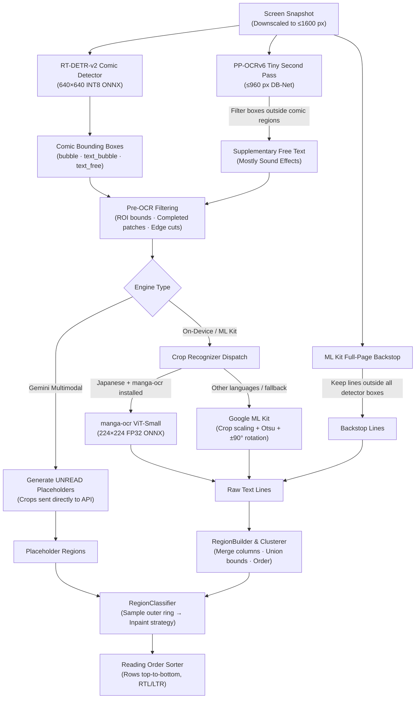

# Detection and OCR Guide

This document details how Panelglass identifies text containers in comic screenshots, reads their contents, and structures raw text into translation regions.

For how detection fits into the broader rendering and scrolling session, see [FLOW.md](FLOW.md).

---

## Contents

- [Architectural Overview](#architectural-overview)
- [Primary Comic Detector (RT-DETR-v2)](#primary-comic-detector-rt-detr-v2)
- [Secondary Detector (PP-OCRv6 Tiny)](#secondary-detector-pp-ocrv6-tiny)
- [Pre-OCR Candidate Filtering](#pre-ocr-candidate-filtering)
- [Recognition Targets & Bounding](#recognition-targets--bounding)
- [OCR Recognizers](#ocr-recognizers)
  - [manga-ocr (Japanese On-Device)](#manga-ocr-japanese-on-device)
  - [Google ML Kit (Multilingual & Rotated Pass)](#google-ml-kit-multilingual--rotated-pass)
- [Full-Page Recall Backstop](#full-page-recall-backstop)
- [Unreadable Text & SFX Handling](#unreadable-text--sfx-handling)
- [Gemini Direct Crop Reading Mode](#gemini-direct-crop-reading-mode)
- [Region Assembly & Clustering](#region-assembly--clustering)
- [Region Classification & Inpainting Strategy](#region-classification--inpainting-strategy)
- [Reading Order Determination](#reading-order-determination)
- [Tuning, Benchmarking & Diagnostics](#tuning-benchmarking--diagnostics)

---

## Architectural Overview

Panelglass uses a **two-tier detection pipeline**: a comic-specific detector identifies speech balloons and text boxes, while a secondary text detector locates brush-lettered sound effects that comic models typically miss. Each candidate crop is read by a specialized recognizer, while a full-page ML Kit pass acts as a recall backstop.



---

## Primary Comic Detector (RT-DETR-v2)

The primary detector identifies comic-specific containers using an anchor-free **RT-DETR-v2** model (`ogkalu/comic-text-and-bubble-detector`).

### Model Specifications

| Parameter | Specification |
|---|---|
| **Architecture** | Real-Time DEtection TRansformer v2 (RT-DETR-v2) |
| **Quantization** | INT8 ONNX (CPU execution via ONNX Runtime / MLAS) |
| **Asset Location** | Bundled in `core/ocr/src/main/assets/` (~11 MB) |
| **Runtime Storage** | Copied to `filesDir/models/` and pinned by file size |
| **Input Shape** | `1 × 3 × 640 × 640` float RGB normalized to `[0.0, 1.0]` (aspect ratio squashed) |
| **Auxiliary Input** | `orig_target_sizes` (`[width, height]` in source pixels) |
| **Output Labels** | `0` = `bubble` (balloon container)<br>`1` = `text_bubble` (text inside balloon)<br>`2` = `text_free` (sound effects or floating text) |
| **Confidence Cutoff** | Detections with confidence `< 0.30` or side `< 4 px` are discarded |
| **Deduplication** | Boxes of the same class with IoU `≥ 0.90` are merged to the highest confidence |

### Snapshot Downscaling
The input bitmap is downscaled so its longest side is at most **1600 px** (`ImageDecoder.forDetection`). All output coordinates are projected back to the original screen dimensions using the inverse scaling factor.

---

## Secondary Detector (PP-OCRv6 Tiny)

Comic detectors are optimized for speech bubbles and frequently miss brush-lettered sound effects and freehand calligraphy. Panelglass runs a concurrent second pass using **PP-OCRv6 Tiny Det**.

> [!NOTE]
> **Performance Benchmark:** On Korean webtoon test screenshots, the primary comic detector identified only 1 of 8 brush-lettered effects. The PP-OCRv6 second pass successfully identified 7 of 8.

### Model Specifications

| Parameter | Specification |
|---|---|
| **Architecture** | PaddleOCR PP-OCRv6 Tiny Detection (DBNet) |
| **Format** | Official FP32 ONNX (~1.8 MB bundled in assets) |
| **Input Shape** | `1 × 3 × H × W` BGR normalized via ImageNet mean and std |
| **Resolution** | Longest side scaled to `≤ 960 px` with dimensions rounded to multiples of 32 |
| **Output** | `1 × 1 × H × W` text probability heat map |
| **Post-Processing** | `DbPostProcess`: threshold at 0.3, keep components with mean probability `≥ 0.6`, unclip by `area × 1.5 / perimeter` |
| **Merging** | Adjacent components closer than half their short side are merged into single words |
| **Exclusion Rules** | Discarded if center lies inside an RT-DETR box, if covered `≥ 30%` by a comic box, if smaller than 2% of page width, or if larger than half the page |

Boxes surviving the second pass join the candidate list as `text_free` regions. Both detectors run concurrently, each with its own ONNX session and lock (about 350 ms per screen on the test phone, at most ~600 ms).

---

## Pre-OCR Candidate Filtering

Because text recognition is computationally expensive, invalid candidates are pruned **before** reading (`detectPage(..., skipRead = true)`):

1. **ROI Containment:** Any box falling outside visible comic image rectangles or underneath fixed navigation headers is discarded (`RegionOfInterest.include`).
2. **Overlay Suppression:** Detections positioned beneath floating controls or the reader's status indicator are excluded (`RegionOfInterest.exclude`).
3. **Patch Deduplication:** Detections covered `≥ 80%` by an active WebP patch from an earlier scroll stop are skipped.
4. **Edge-Cut Deferral:** Speech bubbles clipped by the top or bottom edge of the viewport are deferred until the user scrolls them completely into view.

---

## Recognition Targets & Bounding

Text boxes (`text_bubble` and `text_free`) represent the primary recognition targets:

- **Empty Balloon Fallback:** If a `bubble` container has no internal `text_bubble`, the whole balloon is read as a fallback.
- **Crop Padding:** Each crop is extracted with **6% padding** (minimum 2 px) to prevent clipping glyph edges.
- **Bounding Invariant:** Recognized text coordinates are mapped back to screen space and clamped to the unpadded box so padding never contaminates the inpainting mask.

---

## OCR Recognizers

### manga-ocr (Japanese On-Device)

For Japanese text, Panelglass uses an optimized ONNX export of [manga-ocr](https://github.com/kha-white/manga-ocr) (`l0wgear/manga-ocr-2025-onnx`):

| Property | Detail |
|---|---|
| **Architecture** | Vision Transformer Small (ViT-Small) encoder + BERT-style decoder (~140 MB) |
| **Preprocessing** | Grayscale → RGB, resized to `224 × 224`, normalized to `(x/255 - 0.5) / 0.5` |
| **Decoding** | Greedy autoregressive decoding from `[CLS]` to `[SEP]` (maximum 48 tokens) |
| **Orientation Hint** | Crops taller than wide are flagged as vertical text; font size is estimated from character area |
| **Hallucination Gate** | Free-text crops with confidence `< 0.80` (geometric mean of token probabilities) are dropped to prevent hallucinating Japanese characters over sound effects or screen screentones |

### Google ML Kit (Multilingual & Rotated Pass)

For Korean, Chinese, and Latin scripts (and Japanese fallback), Panelglass runs Google ML Kit with custom heuristics:

- **Dynamic Crop Scaling (`CropScalePlan`):** Small glyph crops are scaled up (up to 3×) until the short side reaches 1200 px. Large crops are capped below 3000 px.
- **High-Contrast Otsu Inversion (`HighContrast`):** If a crop returns zero characters, it is re-read in binary high-contrast (Otsu threshold on luminance, inverting white text on dark art).
- **Rotated "Shadow" Pass (Vertical Japanese):** When upright OCR returns fragmented single-character readings on vertical text, the crop is re-read rotated at `±90°`. The rotation producing the highest CJK character count is selected and marked vertical.
- **Upright Tilt Clamping (`uprightTilt`):** Vertical text angle is normalized to `±45°` of the nearest axis, preventing upright dialogue from being misclassified as angled scene text.

---

## Full-Page Recall Backstop

Concurrent with individual crop recognition, Google ML Kit reads the full screen snapshot. 

A backstop line is retained only if:
1. Its center falls outside every detected bounding box.
2. It overlaps existing boxes by less than 35%.
3. It contains more than a single isolated character (lone glyphs outside containers are discarded as noise).

---

## Unreadable Text & SFX Handling

When detectors identify a high-confidence `text_free` box (`score ≥ 0.5`), but no OCR pass can decode text inside it:
- The region is tagged as `ReadState.UNREADABLE` of type `SFX`.
- If the sound effect mode is set to **Replace**, the region is routed to `RegionRenderer.eraseOnly`.
- If the background art is too complex to inpaint cleanly, the eraser rejects the operation and leaves the original sound effect untouched.

---

## Gemini Direct Crop Reading Mode

When the user selects Google Gemini, on-device OCR is skipped entirely (`read = false`):

1. Detection identifies bounding boxes.
2. Each target box generates a lightweight `ReadState.UNREAD` placeholder.
3. The pipeline packages JPEG crops of each balloon (longest side 512 px, 6% padding) and transmits them directly to Gemini via the multimodal API.
4. Gemini transcribes and translates the image in a single round trip.

> [!TIP]
> **Performance Impact:** On emulated hardware, Gemini crop reading executes in 6–9 s per screen compared to 25–28 s for on-device OCR pipelines.

---

## Region Assembly & Clustering

The `RegionBuilder` aggregates individual text lines into coherent semantic units:

- **Filter Noise:** Lines lacking letters or numbers (`……`, `———`) are dropped.
- **Box Containment:** Multiple lines inside the same balloon (e.g. three vertical columns) are merged into a single sentence.
- **Proximity Clustering (`RegionClusterer`):** Backstop lines are grouped by spatial proximity, font-size similarity, and alignment. Vertical Japanese columns are assembled right-to-left.
- **Balloon Deduplication (`DetectionStage.mergeSameBalloon`):** Multiple text boxes residing inside a single balloon boundary are unified in reading order.
- **Nested Reading Removal (`DetectionStage.dropNested`):** Any smaller text region whose transcription is completely contained within a larger region is discarded.

---

## Region Classification & Inpainting Strategy

`RegionClassifier` inspects an annular ring of pixels (8–12 px radius) surrounding the text bounding box to determine inpainting strategy:

| Outer Ring Characteristics | Region Kind | Inpainting / Erase Method |
|---|---|---|
| **Low variance, high luminance** | `ENCLOSED` (Speech Balloon) | Flood-fill using sampled balloon background color |
| **Low variance, mid/low luminance** | `CAPTION` (Rectangular Box) | Solid fill with sampled caption box color |
| **High variance, text reads like onomatopoeia (`looksLikeSfx`) and glyph ≥ 3% of the short side** | `SFX` (Sound Effect) | Mask and patch over artwork |
| **High variance, tilted ≥ 8°** | `IN_SCENE` | Ray inpainting (weighted median) |
| **High variance, upright** | `FREE` (Floating Text) | Ray inpainting or boundary masking |

> [!NOTE]
> A text box the detector labelled `text_bubble` is already `ENCLOSED` (`RegionBuilder` seeds the kind from the box class); the ring test only sorts free text into `FREE`, `SFX`, `IN_SCENE` and `CAPTION`.

---

## Reading Order Determination

`PanelCutter` first splits the page into panels (recursive X-Y cut); within each panel, `ReadingOrder` groups regions into horizontal bands from top to bottom:
- A new row begins when a region's top edge exceeds `0.75×` the median region height below the current row anchor.
- Japanese pages sort rows **right-to-left (RTL)**.
- Korean, Chinese, and English pages sort rows **left-to-right (LTR)**.
- On-device LLMs receive regions dispatched in batches of 4 following this exact reading sequence.

---

## Tuning, Benchmarking & Diagnostics

### ONNX Runtime CPU Tuning (`OrtBench`)
Both RT-DETR-v2 and manga-ocr run on ONNX Runtime CPU with MLAS optimizations. To benchmark execution options on an attached device:

```bash
adb shell run-as com.smnexstudio.panelglass.debug touch files/debug-ortbench
adb logcat -s OrtBench
```

*(Delete `files/debug-ortbench` when benchmarking is finished).*

### Diagnostic Dumps
To inspect bounding boxes, crop images, OCR confidence scores, and classifications:
```bash
adb shell run-as com.smnexstudio.panelglass.debug mkdir -p files/debug-dump
```
Each translation session outputs `page.png`, `regions.txt` (bounding boxes, transcription, confidence, classifications), and the rendered `patch-*.webp` bitmaps.
