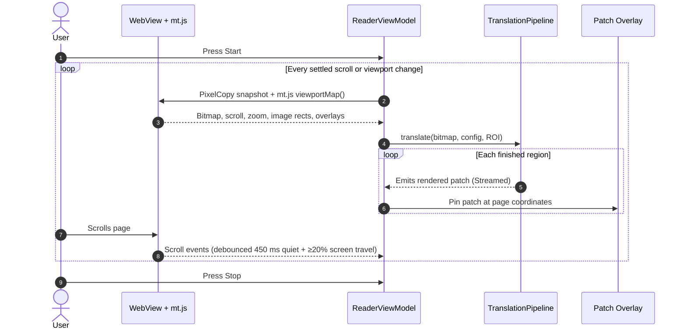
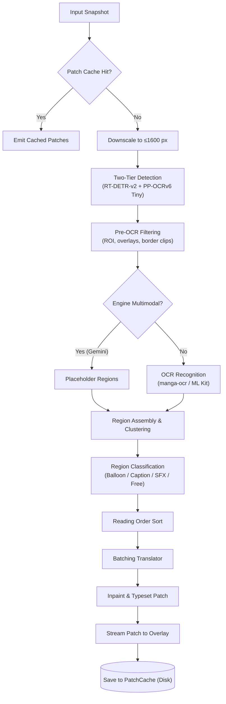

# Translation Flow Guide

This document tracks a comic page from the moment **Start** is pressed in the reader to the native rendering of translated lettering over the artwork.

For underlying module boundaries and component architecture, see [ARCHITECTURE.md](ARCHITECTURE.md). For text detection and OCR internals, see [DETECTION_AND_OCR.md](DETECTION_AND_OCR.md).

---

## Contents

- [Session Lifecycle](#session-lifecycle)
- [Viewport Capture & Page Mapping](#viewport-capture--page-mapping)
- [Pipeline Architecture & Stages](#pipeline-architecture--stages)
- [Translation Dispatch & Batching](#translation-dispatch--batching)
- [Erasing, Inpainting & Lettering](#erasing-inpainting--lettering)
- [Live Patch Projection & Scroll Anchoring](#live-patch-projection--scroll-anchoring)
- [Whole-Page Automated Scan](#whole-page-automated-scan)
- [Failure Handling & Recovery](#failure-handling--recovery)
- [Diagnostics & Debugging](#diagnostics--debugging)
- [Page DOM Translation Mode](#page-dom-translation-mode)

---

## Session Lifecycle

Screen translation operates as a continuous reactive loop. **Start**, per-site auto-translate, and **Re-translate** all run this session.



### Session Triggers
A new viewport capture is triggered by:
1. **Settled Scroll:** 450 ms of touch inactivity after moving at least 20% of a screen.
2. **Pending Image Completion:** Captures taken over partially loaded images are repeated once loading finishes (polled every 1 s for up to 3 minutes).
3. **Canvas Loading Settle:** HTML5 canvas readers (e.g. Bilibili) that yield zero text are automatically retried once 2 seconds later.
4. **Orientation Change or Window Resize:** Rotation clears active patches and triggers re-capture 1.2 s later once layout reflow completes.
5. **Page Turns (Paged Readers):** In tap-to-turn readers, thumbnail luminance deltas detect page changes and trigger retranslation.
6. **Automatic Language Switching:** When DOM inspection detects a change in comic language, the session switches sources and clears patches.
7. **Glossary Updates:** Closing the *Glossary & pronouns* sheet after an edit flushes patches and translates the viewport with the new context.

---

## Viewport Capture & Page Mapping

The capture phase (`ScreenTranslate.captureViewport`) produces a clean `ViewportCapture`:

```
┌────────────────────────────────────────────────────────┐
│ 1. Image Settle Wait → Poll up to 3 s for pending images│
│ 2. PixelCopy Read    → Hardware surface snapshot       │
│ 3. Coordinate Sync   → Capture scroll offset & zoom    │
│ 4. mt.js Bridge      → Query DOM layout map            │
└────────────────────────────────────────────────────────┘
```

1. **Wait for In-Flight Images:** Polls every 250 ms (up to 3 s) until `viewportMap()` reports zero loading images in view.
2. **Hardware PixelCopy:** Uses `PixelCopy` to snapshot the composite surface, capturing hardware-accelerated canvases and WebGL tiles without DOM modification.
3. **DOM Mapping (`mt.js`):** Injected helper script returns:
   - `images`: Rectangles and unique keys for visible `` and `<canvas>` elements.
   - `overlays`: Bounding boxes of floating bars, sticky headers, or full-screen overlays (checked via `elementFromPoint`).
   - `pending`: Count of loading assets.
4. **Region of Interest (ROI) Synthesis:**
   - **Include:** Pixel regions overlapping confirmed comic artwork.
   - **Exclude:** Floating website bars, menus, and the reader's status indicator disc.
   - **Done:** Areas already covered by an existing high-confidence patch.

---

## Pipeline Architecture & Stages

`TranslationPipeline.translate` orchestrates detection, recognition, translation, and rendering:



### Architectural Guarantees
- **Series Resolution First:** Glossaries and notes are merged and hashed before cache inspection.
- **Dynamic Detection:** Bounding boxes are computed dynamically on every scroll step; only rendered patches are cached.
- **Immediate Streaming:** Each region's patch is emitted the instant it finishes rendering, allowing bubbles to appear progressively on screen.
- **Async WebP Encoding:** Overlays render raw in-memory bitmaps immediately; disk caching encodes WebP asynchronously off the main thread.

---

## Translation Dispatch & Batching

`BatchingTranslator` coordinates requests to cloud APIs and on-device neural runtimes:

### Cloud LLMs (Gemini / Custom AI)
- **Batching:** Up to 60 text items per network call to amortize HTTP round-trip latency.
- **Strict Output Budgets:** Max token limit enforced at `300 + 120` tokens per bubble (capped at 8,192 total tokens).
- **Format Contract (`LlmContract`):** Structured JSON array exchange (`[{i, text}]`). Gemini direct crop mode receives JPEG image crops and returns `{i, source, text}`.
- **Custom AI Fault Tolerance:** Supports non-standard self-hosted server replies (code blocks, wrapped objects). Employs self-contained retry messages (`selfContainedRetry`).

### On-Device LLMs (LiteRT-LM Gemma 4 & Qwen 2.5)
- **Context Groups:** Viewport regions are dispatched in sequential batches of 4 bubbles following reading order.
- **KV Cache Protection:** Prompts are restricted to a maximum of 12 items to stay within the 4096-token shared KV cache.
- **Output Sanitization:** Strips accidental source echoes (`withoutSource`) and purges foreign script contamination (`withoutStrayScript`).

---

## Erasing, Inpainting & Lettering

`RegionRenderer` converts translated text into clean visual patches:

### 1. Inpainting & Background Erase (`TextEraser`)
- **Speech Balloons (`ENCLOSED`):** Flood-fills the detected paper color outwards from the text box. Erases original lettering and accidental noise ("……") while preserving balloon contours.
- **Captions (`CAPTION`):** Solid-fills using the sampled caption box background color.
- **Free Floating Text (`FREE`, `IN_SCENE`):** Extracts an Otsu glyph mask, expands boundaries by 8% of character height to catch dark stroke outlines, and applies multi-directional ray inpainting.
- **Unreadable Sound Effects:** Erased cleanly only if the background art variance is low enough to prevent smearing.

### 2. Geometry Fitting (`BalloonFit`)
- Flood-fills balloon paper to trace its true organic contour (oval, shout, polygon).
- Evaluates candidate text bounding shapes to find the maximum legible font size.
- Clips rendered typography strictly inside the traced balloon boundary.

### 3. Font Autosizing & Wrap (`TextFit`)
- Binary searches for optimal font size (minimum 12 px).
- Enforces strict constraints: total height must fit balloon bounds; unbreakable words must fit box width.
- Allows vertical text columns to widen up to 2.5× to preserve legibility.

---

## Live Patch Projection & Scroll Anchoring

Patches are rendered as native Android Compose layers above the WebView:

- **Coordinate Normalization:** Patches are positioned in CSS page coordinates:
  $$\text{Page CSS} = \frac{\text{Capture Scroll} + \text{Snapshot Offset}}{\text{Capture Zoom}}$$
- **Hardware-Accelerated Tracking:** The Compose overlay draws each patch at:
  $$\text{Screen X/Y} = \text{CSS Rect} \times \text{Live Zoom} - \text{Live Scroll}$$
- **Image Re-anchoring (`reanchor`):** Each patch binds to its underlying comic `` or `<canvas>` element key. When lazy-loading causes page reflow, patches move automatically with their parent image.
- **Memory Distance Pruning:** During normal continuous reading, patches farther than 3 full viewports from the visible screen are pruned from memory and re-rendered on return.

---

## Whole-Page Automated Scan

Accessed via reader **⋮ › Translate whole page**:

```
┌────────────────────────────────────────────────────────┐
│ 1. Compute Steps   → 70% viewport steps (30% overlap)  │
│ 2. Scroll & Settle → 700 ms settle delay per step       │
│ 3. Lazy Page Check → Poll bottom 1.5 s for new content │
│ 4. Return to Start → Auto-scrolls back when finished   │
└────────────────────────────────────────────────────────┘
```

- **Overlap Protection:** Scans in 70% viewport steps (30% overlap), ensuring no speech bubble is cut in half. Maximum 120 steps per chapter.
- **Lazy Load Growth:** Evaluates page height via JavaScript after each step. At the bottom, waits 1.5 s to detect lazy-loaded comic pages.
- **96 MB Bitmap Memory Budget:** Replaces the 3-screen pruning rule with a strict **96 MB** decoded bitmap cache budget (`PAGE_PATCH_BUDGET_BYTES`). Farthest patches are dropped first if memory exceeds the threshold.
- **Cancellation:** **Cancel scan** stops the loop and scrolls back to where it started. Touching the page also stops it, but stays where the reader scrolled to.
- **Failure Resilience:** Transient failures (network, unavailable, overloaded) are retried twice (after 2 s, then 4 s); a stop that still fails is skipped and counted as a gap. A missing key, exhausted quota or missing language pack ends the scan at once, since every later stop would fail the same way, and the bar offers the fix.

---

## Failure Handling & Recovery

| Failure Condition | User Interface State | Action / Recovery |
|---|---|---|
| **Missing API Key** | "Gemini needs an API key" | Opens API key input bottom sheet |
| **Quota Depleted** | "... quota exhausted" | Offers a one-tap switch to on-device Google Translate (never automatic) |
| **Network Interruption / Unavailable** | "... is unavailable right now" | Rate limits are retried up to 3×, overload up to 2×, with short backoff; then the same one-tap offer (none when the engine is already Google Translate) |
| **Watchdog Timeout** | "... took too long" (50 s stage limit) | Cancels the stage; scroll or Re-translate to retry |
| **Missing Language Pack** | "… language pack needs downloading" | One-tap **Download**, then the capture retries |

---

## Diagnostics & Debugging

- **Logcat Timings:** Inspect pipeline performance under the `TranslationPipeline` tag:
  ```
  timing GOOGLE: decode+detect+ocr=340ms translate=45ms render=60ms total=445ms
  ```
- **Session State Tracking:** `ScreenSession` holds the patches and their anchors; `ViewportCapture` holds one capture (bitmap, scroll, zoom, image rects, overlays).
- **Filesystem Diagnostics Dump:**
  ```bash
  adb shell run-as com.smnexstudio.panelglass.debug mkdir -p files/debug-dump
  ```
  Generates `page.png`, `regions.txt` (bounding boxes, classifications, font fit attempts), and individual `patch-*.webp` files.

---

## Page DOM Translation Mode

Accessed via **⋮ › Translate page**:
- Translates website navigation, chapter titles, user comments, and raw HTML text.
- Inspects visible DOM nodes with `pt.js`, translates text using on-device Google ML Kit, and updates DOM elements in place.
- Selecting **Show original** restores original DOM text.
