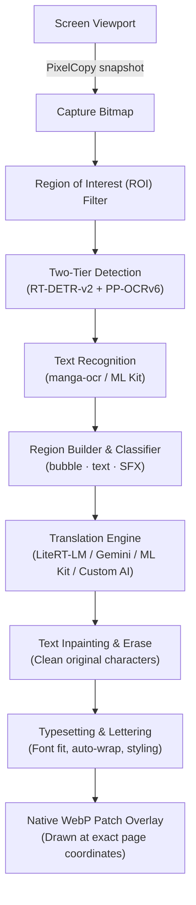

# Panelglass Documentation

Welcome to the **Panelglass** documentation hub. This guide organizes the complete architecture, translation pipeline, AI engines, testing suites, and development workflows for Panelglass — an open-source, on-device AI manga, manhwa, and webtoon translator for Android.

---

## Quick Navigation

| Document                                                | Target Audience          | Key Focus                                                                       |
| ------------------------------------------------------- | ------------------------ | ------------------------------------------------------------------------------- |
| [**Architecture**](ARCHITECTURE.md)                     | Developers, Architects   | Module topology, runtime components, security model, FR/NFR requirements        |
| [**Translation Flow**](FLOW.md)                         | Developers, AI Engineers | End-to-end lifecycle of a screen: capture, pipeline, rendering, whole-page scan |
| [**Detection & OCR**](DETECTION_AND_OCR.md)             | Vision / ML Engineers    | RT-DETR-v2 detector, PP-OCRv6 2nd pass, manga-ocr, ML Kit, region building      |
| [**Translation Quality**](TRANSLATION_QUALITY.md)       | Users, Translators       | Engine selection, glossary, pronoun tracking, translation notes, sound effects  |
| [**Memory Usage**](MEMORY_USAGE.md)                     | Performance Engineers    | Real-device RAM benchmarks, heap budgets, model lifecycle, leak prevention      |
| [**Testing Catalogue**](TESTING.md)                     | QA, Contributors         | 879 JVM unit tests, instrumented tests, real-device manual verification checks |
| [**Local Readers Proposal**](PROPOSAL_LOCAL_READERS.md) | Product, Contributors    | Design proposal for archive formats (CBZ, 7z) and global screen overlays        |
| [**Contributing Guide**](../CONTRIBUTING.md)            | Contributors             | PR guidelines, coding standards, release checklist, branch conventions          |
| [**Changelog**](../CHANGELOG.md)                        | All                      | Version history, recent features, breaking changes, and bug fixes               |

---

## Documentation by Reading Path

Choose the reading track that fits what you want to achieve:

### 1. Using & Tuning Translations

_Goal: Get the best possible translation accuracy for manga, manhwa, and webtoons._

1. **[Main README](../README.md):** Features, installation, quick start, and supported languages.
2. **[Translation Quality Guide](TRANSLATION_QUALITY.md):**
   - Choosing the right engine for the series (Gemini vs. on-device Gemma/Qwen vs. ML Kit).
   - Setting up character glossaries and pronoun hints (he/she/they).
   - Crafting global and series-specific translation notes.
   - Configuring sound effects (_Keep_ vs. _Replace_).
3. **[Changelog](../CHANGELOG.md):** What's new in each release.

### 2. Android & Architecture Engineering

_Goal: Understand the app architecture, state management, and data layers._

1. **[Architecture Guide](ARCHITECTURE.md):**
   - Single-Activity Jetpack Compose design and Gradle module boundaries (`app`, `feature/*`, `core/*`).
   - Functional (`FR`) and Non-Functional (`NFR`) requirements mapped to test evidence.
   - Storage architecture: Room, DataStore, and Android Keystore encryption for API keys.
   - Backup & restore specification (`AppBackup.kt`).
2. **[Translation Flow](FLOW.md):**
   - Viewport snapshot capture (`PixelCopy`) and DOM isolation.
   - Continuous scroll tracking with 450 ms quiet-settle debouncing.
   - Whole-page auto-scanner loop with 96 MB bitmap memory budgeting.
3. **[Local Readers Proposal](PROPOSAL_LOCAL_READERS.md):**
   - Architectural plan for importing complex archives and system-wide screen overlays.

### 3. Computer Vision, OCR & AI Models

_Goal: Learn how bubbles are detected, cropped, read, translated, and inpainted._

1. **[Detection and OCR](DETECTION_AND_OCR.md):**
   - Two-tier detection: `RT-DETR-v2` (comic balloon detector) + `PP-OCRv6 tiny` (second-pass SFX detector).
   - Text recognition: `manga-ocr` (Japanese ONNX) and Google ML Kit (multilingual + rotated pass).
   - Backstop full-page OCR and text line aggregation (`RegionBuilder`).
2. **[Translation Flow](FLOW.md):**
   - Pipeline orchestration (`TranslationPipeline.translate`).
   - In-place erasing, background inpainting, text fitting, and WebP patch generation.
3. **[Memory Usage](MEMORY_USAGE.md):**
   - Peak RAM footprints per engine on Android hardware.
   - ONNX Runtime and LiteRT-LM memory management and trim policies.

### 4. Testing, QA & Verification

_Goal: Run test suites, verify fixes, and benchmark performance._

1. **[Testing Catalogue](TESTING.md):**
   - Full index of JVM unit test classes grouped by module.
   - Instrumented device tests.
   - 28-step manual testing protocol on physical Android devices.
2. **[Contributing Guide](../CONTRIBUTING.md):**
   - Clean build instructions (`./gradlew testDebugUnitTest`).
   - Strict repository rules (no personal data in logs, strict scheme validation, etc.).

---

## High-Level System Architecture

Panelglass enforces a strict unidirectional dependency structure across three layers:

```
┌─────────────────────────────────────────────────────────────┐
│                         app                                 │
│         (MainActivity, Navigation Host, In-App Update)      │
└──────────────┬───────────────────────────────┬──────────────┘
               ▼                               ▼
┌───────────────────────────────┐ ┌───────────────────────────┐
│       feature/browser         │ │      feature/studio       │
│  (WebView Reader, Overlays,   │ │ (Chapter Import, Review,  │
│     Whole-Page Scanner)       │ │  Lettering, CBZ Export)   │
└──────────────┬────────────────┘ └────────────┬──────────────┘
               │   ┌───────────────────────────┤
               │   │ feature/library & settings│
               ▼   ▼                           ▼
┌─────────────────────────────────────────────────────────────┐
│                         core                                │
│  ┌────────────────────┐ ┌──────────────────┐ ┌───────────┐  │
│  │   core/pipeline    │ │   core/render    │ │ core/ocr  │  │
│  │ (Translation loop) │ │ (Erase & Letter) │ │ (Detect)  │  │
│  └─────────┬──────────┘ └────────┬─────────┘ └─────┬─────┘  │
│            ▼                     ▼                 ▼        │
│  ┌────────────────────┐ ┌──────────────────┐ ┌───────────┐  │
│  │    core/engine     │ │    core/data     │ │  core/ui  │  │
│  │ (LLMs, ML Kit, SFX)│ │ (Room, Keystore) │ │ (Compose) │  │
│  └────────────────────┴─┴──────────────────┴─┴───────────┘  │
│                                  │                          │
│                                  ▼                          │
│                         ┌──────────────────┐                │
│                         │    core/model    │                │
│                         │  (Pure Kotlin)   │                │
│                         └──────────────────┘                │
└─────────────────────────────────────────────────────────────┘
```

---

## The Translation Pipeline at a Glance

When reading in the browser or processing pages in Studio, every screen follows this pipeline:



> [!NOTE]
> **DOM Immutability Principle:** Panelglass never alters the webpage's DOM or injects translation text into HTML nodes. Instead, translated speech bubbles are rendered as native WebP image patches pinned directly over the WebView, allowing smooth hardware-accelerated scrolling and zooming.

---

## AI Translation Engines Matrix

Panelglass gives users complete flexibility over AI engines, from privacy-first offline models to high-capacity cloud models:

| Engine            | Execution Mode         | API Key Needed? | Memory (RAM)      | Best Suited For                                                       |
| ----------------- | ---------------------- | --------------- | ----------------- | --------------------------------------------------------------------- |
| **Google ML Kit** | On-Device (Offline)    | No              | Minimal (~30 MB)  | Fast, lightweight everyday reading; literal translations              |
| **Gemma 4 E2B**   | On-Device (Offline)    | No              | High (~1.8 GB)    | High quality dialogue, complex context, honorifics & pronoun accuracy |
| **Qwen 2.5 1.5B** | On-Device (Offline)    | No              | Medium (~1.1 GB)  | Balanced offline AI translation on phones with 6–8 GB RAM             |
| **Google Gemini** | Cloud (Vision + LLM)   | Yes (User Key)  | Minimal (Network) | Highest accuracy; translates directly from image crops                |
| **Custom AI**     | Cloud / Local Endpoint | Optional        | Minimal (Network) | Custom models via any OpenAI-compatible HTTPS endpoint                |

---

## Core Codebase Directory Map

```
Panelglass/
├── app/                  # Application root: Hilt application, MainActivity, navigation graph
├── core/
│   ├── model/            # Pure Kotlin domain types: languages, regions, settings, errors
│   ├── data/             # Room DB, DataStore, Keystore crypto, AppBackup, pack downloader
│   ├── engine/           # Engine registry, Gemini client, LiteRT-LM, ML Kit, SFX dictionary
│   ├── ocr/              # RT-DETR-v2 detector, PP-OCRv6 pass, manga-ocr ONNX, ML Kit
│   ├── render/           # Bubble erasing, inpainting, font measurement, WebP patch rendering
│   ├── pipeline/         # TranslationPipeline: orchestrates detect → OCR → translate → render
│   └── ui/               # Reusable Compose components, design system tokens, 16 UI translations
├── feature/
│   ├── browser/          # Reader WebView, viewport capture, patch overlay, whole-page scan
│   ├── studio/           # Manga studio: CBZ/ZIP/PDF import, review editor, lettering, export
│   ├── library/          # Saved sites, bookmarks, history, per-site language overrides
│   └── settings/         # Engine picker, model manager, glossary, translation notes, backup
└── docs/                 # Architectural specifications, quality guides, test docs (YOU ARE HERE)
```

---

## Key Concepts & Glossary

| Term                         | Definition                                                                                                                                            |
| ---------------------------- | ----------------------------------------------------------------------------------------------------------------------------------------------------- |
| **Capture**                  | A high-fidelity bitmap snapshot of the reader's visible screen taken via `PixelCopy`.                                                                 |
| **Region**                   | A discrete bounding box enclosing text: a speech balloon (`bubble`), caption (`text_free`), or sound effect (`sfx`).                                  |
| **Patch**                    | A lightweight WebP bitmap containing the erased background and freshly typeset translated text.                                                       |
| **Patch Overlay**            | A native Android Compose layer positioned directly above the WebView that scales and scrolls patches in sync with the page.                           |
| **ROI (Region of Interest)** | The active reading canvas; viewport areas covered by website navigation headers, floating ads, or toolbars are excluded.                              |
| **Second Pass**              | The supplementary `PP-OCRv6` detector run to capture stylized sound effects and uncontained text missed by the comic detector.                        |
| **Whole-Page Scan**          | An automated reading mode that scrolls the entire page step-by-step, translating each segment and caching patches under a strict 96 MB memory budget. |
| **Series Scope**             | The domain and path hierarchy used to isolate character glossaries and translation notes (e.g. `site.com/series-name`).                               |
| **In-Place Lettering**       | Removing the original foreign script while preserving speech bubble outlines and redrawing the translated text formatted to fit the bubble geometry.  |
| **Debug Build**              | The side-by-side development package (`com.smnexstudio.panelglass.debug`) equipped with diagnostic dump tools and verbose logging.                    |

---

## Contributing to Documentation

When updating or adding documentation:

- **Keep Requirements Updated:** If code changes alter functional behavior, update the corresponding `FR` or `NFR` table in [ARCHITECTURE.md](ARCHITECTURE.md) and link the test in [TESTING.md](TESTING.md).
- **Maintain Markdown Links:** Always use relative links between documents (e.g., `[Translation Flow](FLOW.md)`).
- **Use Clear Diagrams:** Use GitHub-flavored Mermaid blocks for state machines, sequence diagrams, and flowcharts.
- **Run Unit Tests:** Ensure all documentation-related test suites (e.g. `MarkdownLiteTest`) pass before submitting pull requests:
  ```powershell
  ./gradlew testDebugUnitTest
  ```
